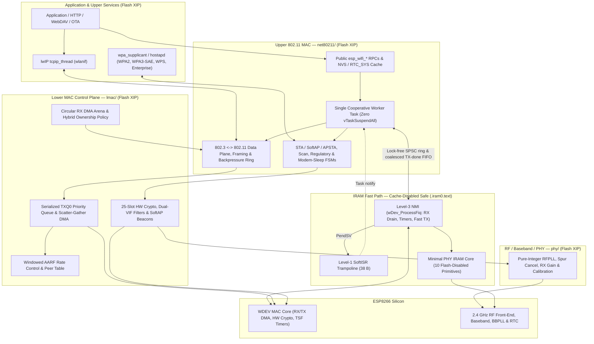
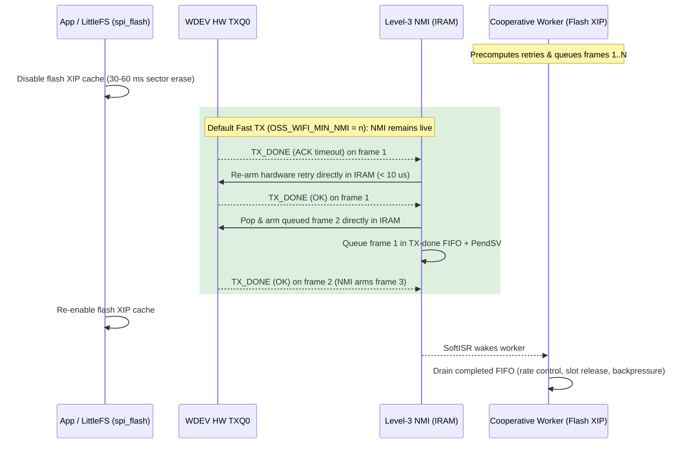
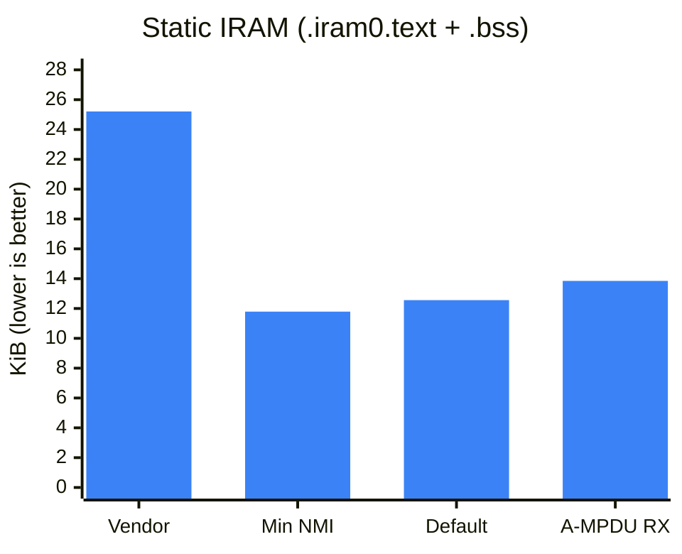
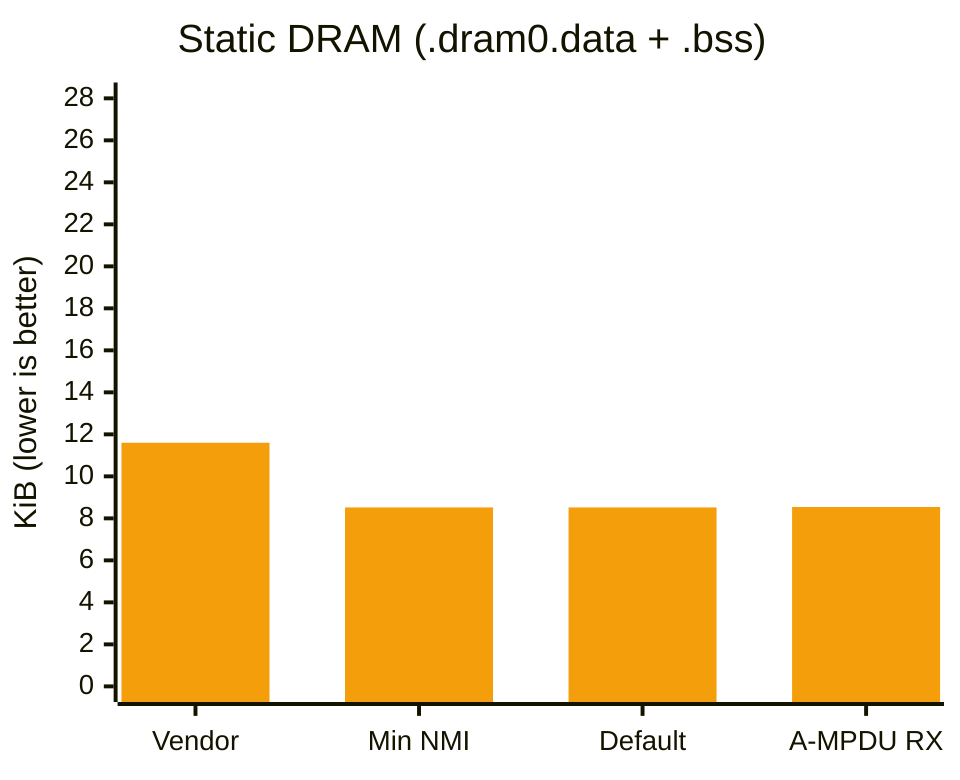

# ESP8266 Open-Source Wi-Fi Stack — Architecture Notes (`WIFI_DESIGN.md`)

Design notes for the clean-room open-source Wi-Fi stack in `components/esp8266/` (`phy/`, `lmac/`, `net80211/`), replacing the proprietary `libphy.a`, `libpp.a` (`_dbg`), and `libnet80211.a` (`_dbg`) archives in `ESP8266_RTOS_SDK` (GCC 16.2).

- For module-by-module provenance, file inventories, Kconfig hierarchy, and license attribution, see [OSS.md](OSS.md).
- For reproducible device benchmarking instructions, see [test/WIFI_BENCHMARK.md](test/WIFI_BENCHMARK.md).

---

## 1. Design Thesis & Silicon Constraints

Every major choice in this stack flows from four hard realities of the ESP8266 (Xtensa LX106):

1. **Scarce IRAM (`32 KiB`)** — Shared among exception vectors, RTOS/SPI-flash critical paths, and code that must run while flash is unavailable. Blanket placement of Wi-Fi archives into IRAM leaves almost no headroom for application code or 32-bit heap.
2. **Tight DRAM (`80 KiB`)** — Shared by application heap, lwIP, TLS (`mbedtls`), and Wi-Fi DMA arenas. Static worst-case pools for features that are idle (such as SoftAP or sniffer mode) directly erode system stability.
3. **Execute-in-Place (XIP) Flash Stalls** — Writing or erasing SPI flash (OTA, LittleFS, WebDAV) disables the flash XIP cache for `30–60 ms`, pausing every flash-resident FreeRTOS task while Level-3 NMI remains live in IRAM.
4. **Single-Core MCU + Quirky Radio Hardware** — Application logic, TCP/IP, TLS, and 802.11 state machines share one CPU core alongside the WDEV MAC peripheral, whose hardware multi-queue transmit engine is prone to contention stalls.

**Drop-in compatibility, new internals.** Rather than introducing a custom Wi-Fi API, the stack preserves full source and ABI compatibility with `esp_wifi_*`, `tcpip_adapter` / lwIP, and `wpa_supplicant` / `hostapd` — covering STA, SoftAP, APSTA, promiscuous sniffer, WPA2-PSK, WPA3-SAE with 802.11w PMF, WPS and WPA2-Enterprise hooks, modem sleep, regulatory power clamping, and optional WMM/QoS, A-MPDU RX, RX defragmentation, and 802.11k/11v roaming — while rethinking IRAM placement, concurrency, queueing, and memory ownership around those four constraints.

### Vendor Blobs vs. Open-Source Stack at a Glance

| Dimension | Vendor Blobs (`libphy` / `libpp` / `libnet80211`) | Open-Source Stack (`phy/` / `lmac/` / `net80211/`) | Practical Impact |
| :--- | :--- | :--- | :--- |
| **IRAM Placement** | Blanket `noflash_text` linker rules across `libphy.a` and `libpp.a` (`25.2 KiB` static IRAM) | Targeted IRAM strictly on Level-3 NMI, SoftISR trampoline, and 10 flash-disabled PHY primitives (`12.6 KiB` default; `11.8 KiB` with [`MIN_NMI=y`](#cfg-oss-wifi-min-nmi)) | **-50.2% to -53.2% static IRAM**, unlocking `+23.6%` to `+34.9%` more runtime heap |
| **Concurrency Model** | `ppT` task using scheduler-wide freezes (`vTaskSuspendAll`) | Single cooperative worker task + lock-free NMI ring + brief hardware critical sections | **Zero scheduler freezes**; predictable RTOS and HTTP tail latency |
| **TX Queueing** | Multi-queue hardware WDEV TX (`q=0..7`) with complex stall recovery | Serialized hardware **`TXQ0`** with software priority ordering + default IRAM NMI retry/launch | Eliminates multi-queue hardware lockups and keeps TX moving across flash erases |
| **Rate Control & RF Math** | Closed rate table; mixed soft-float and legacy GCC 5.2 codegen | Pure-integer windowed AARF (up to `MCS7-SGI`, `72.2 Mbps`) and integer fractional-N RFPLL | **Zero soft-float helpers** linked; high sustained throughput with fast fade fallback |
| **Reconnect & Credentials** | Synchronous key derivation on association; NVS-only storage | Eager caller-task PBKDF2-SHA1 + optional [64-byte `RTC_SYS` warm-reboot PMK/channel cache](#cfg-oss-wifi-rtc-fast-connect) | **Zero worker stalls** during setup; ~`0.6–0.8 s` faster warm-reboot reconnect |
| **Memory Ownership** | Static worst-case connection pools always resident; `~1.6 KiB` flat TX buffers | Scatter-gather TX descriptors (`~216 B`/slot), mode-scoped SoftAP peer slabs, `0 B` opt-in features | **-26.6% static DRAM** (`-3.1 KiB`) and **-14.7% flash binary** (`-83.7 KiB`) |

---

## 2. System Topology & the Execution-Context Wall

The stack is partitioned vertically into three bounded layers — **RF/Baseband PHY (`phy/`)**, **Lower MAC (`lmac/`)**, and **Upper 802.11 MAC (`net80211/`)** — and bisected horizontally by one hard execution boundary: **IRAM** (safe when the SPI flash cache is off) versus **Flash XIP** (everything else).

---

## 3. Core Architectural Decisions

### 3.1 The IRAM Diet & Surviving Flash-Cache Stalls

The vendor stack maps almost all of `libphy.a` and `libpp.a` unconditionally into IRAM (`25.2 KiB`), starving the rest of the system. In the open-source stack, IRAM residency is strictly opt-in: only the **10 PHY primitives** invoked from NMI or flash-off sleep transitions, the `38 B` SoftISR trampoline (`MacIsrSigPostDefHdl`), and the Level-3 NMI handler (`wDev_ProcessFiq`, compiled with `-fno-jump-tables` and audited for zero flash references) live in IRAM. Calibration, channel synthesis, rate adaptation, DMA bookkeeping, crypto key programming, and all 802.11 protocol state machines stay in flash XIP. That single discipline cuts static IRAM by more than half.

Moving the worker to flash introduces one unavoidable physical trade-off: during a `30–60 ms` SPI flash sector erase (or sustained flash read bursts), the CPU disables the SPI flash XIP cache and pauses all flash-resident tasks while Level-3 NMI stays live. If TX retries and next-frame launches wait for the flash-resident worker to wake back up, in-flight bursts stall and modem-sleep wakes stretch out.

To eliminate that stall without giving back our IRAM savings, the **default configuration** keeps a small, division-free TX retry and next-slot launch path inside Level-3 NMI (`+789 B` IRAM). The worker precomputes each frame's retry rate schedule and queues slots onto `TXQ0`; if flash pauses mid-burst, the NMI services ACK timeouts and immediately arms the next queued frame in `< 10 µs`, coalescing finished slots into a lock-free completion FIFO that consumes zero event-ring entries. Once flash resumes, the worker drains completions for rate-control accounting and backpressure release. Firmware that rarely writes flash and wants every last byte of IRAM can compile this path out via [`CONFIG_ESP8266_OSS_WIFI_MIN_NMI=y`](#cfg-oss-wifi-min-nmi).

### 3.2 Cooperative Single-Worker Concurrency

Rather than guarding shared MAC state with scheduler-wide freezes (`vTaskSuspendAll`), the entire upper MAC and lower-MAC control plane executes on **one cooperative FreeRTOS worker task**. Public `esp_wifi_*` mutating APIs marshal cleanly onto this worker as synchronous RPCs; hardware events arrive from Level-3 NMI through a lock-free single-producer/single-consumer ring and coalesced wakeup flags; and each wake runs bounded slices of RX drain, TX completion, and software timers so no single burst can monopolize the CPU.

Because only one task mutates MAC state, there are no coarse scheduler locks — only brief interrupt-masked windows where hardware registers or lock-free ring pointers are updated. Expensive work is kept off the worker entirely: WPA2-PSK PBKDF2-SHA1 key derivation runs eagerly on the **caller's task** inside `esp_wifi_set_config()`, preventing worker stalls during credential updates or roaming. When [`CONFIG_ESP8266_OSS_WIFI_RTC_FAST_CONNECT`](#cfg-oss-wifi-rtc-fast-connect) is enabled, the derived 32-byte PMK, BSSID, and channel are cached in `64 B` of `RTC_SYS` memory across warm resets and OTA reboots (auto-cleared on power-on reset), skipping PBKDF2 and probing the last known channel first to cut warm-reboot reconnect time by roughly a second.

### 3.3 Serialized `TXQ0`, Pure-Integer Rate Control & Hardware-Assisted Crypto

- **Single Hardware TX Queue, Software Priority**: The ESP8266 WDEV hardware exposes multiple transmit queues, but driving them concurrently triggers hardware backoff lockups under contention. Rather than building fragile multi-queue recovery heuristics, the stack serializes all transmissions onto hardware **`TXQ0`** while maintaining strict FIFO-within-priority ordering in software (voice, management, and SoftAP beacons ahead of video, best-effort, and background traffic).
- **Pure-Integer PHY & Windowed Rate Adaptation**: Both RFPLL fractional-N channel synthesis (`phy/`) and transmit rate control (`lmac/`) use strictly 64-bit/32-bit integer arithmetic, linking zero soft-float helpers. Rate adaptation runs a windowed AARF algorithm across 802.11b/g and HT20 MCS rates — promoting up to `MCS7-SGI` (`72.2 Mbps`) on capable links, clamping weak initial links, falling back non-linearly across per-packet retries on sudden fades, and enabling RTS/CTS automatically on larger frames whenever ERP/HT protection or sustained retry bursts warrant it.
- **Hardware Crypto With Seamless Software PMF**: Bulk data encryption uses the WDEV's 25-slot hardware crypto engine (WEP, TKIP including hardware TX and RX Michael MIC, and CCMP across STA and SoftAP). For 802.11w Protected Management Frames (PMF) — which the hardware does not offload — the stack performs software CCMP and BIP-CMAC while coordinating hardware TX encryption bypass across dual-VIF APSTA links so software-protected frames are never double-encrypted.

### 3.4 Memory Ownership & Pay-for-What-You-Use Footprint

The `~14–19 KiB` runtime heap advantage over Vendor Blobs comes from eliminating static worst-case buffers and copy-heavy packet paths:

- **Scatter-Gather TX & Backpressure**: Instead of reserving `~1.6 KiB` flat bounce buffers per TX slot, each slot holds compact scatter-gather DMA descriptors (`~216 B` default, `~188 B` with Minimal NMI) that read lwIP `pbuf` payload segments directly from DRAM without copying frame bodies. A bounded ring between lwIP and the worker applies backpressure before advancing 802.11 sequence or cipher packet numbers.
- **Contiguous RX DMA Ring with Hybrid Ownership**: Hardware receives into a contiguous ring of `524 B` DMA buffers drained by NMI in microseconds with zero heap allocation. The worker strips FCS, linearizes ring wrap-arounds safely, and uses [`CONFIG_ESP8266_WIFI_LEFT_CONTINUOUS_RX_BUFFER_NUM`](#cfg-wifi-left-continuous-rx-buffer-num) to decide between immediate heap-copy (returning DMA descriptors at once — the safe default) and zero-copy handoff into lwIP when both contiguous DMA headroom and 8-bit free DRAM (`> 6 KiB`) permit.
- **Zero Idle Footprint**: SoftAP peer slabs exist only while SoftAP is running and are freed completely on stop; promiscuous sniffer rings allocate only while sniffing is active. Optional features compile out to **`0 B`** when disabled — including A-MPDU RX ([`CONFIG_ESP8266_WIFI_AMPDU_RX_ENABLED`](#cfg-wifi-ampdu-rx-enabled)), RX defragmentation ([`CONFIG_ESP8266_OSS_WIFI_RX_DEFRAG_ENABLED`](#cfg-oss-wifi-rx-defrag-enabled)), and 802.11k/11v roaming hooks ([`CONFIG_WPA_11KV_SUPPORT`](#cfg-wpa-11kv-support)). Even always-wired WPS and WPA2-Enterprise glue links `0 B` of `wps` or `eap_peer` code via `--gc-sections` when unused. Non-Wi-Fi projects can also select `CONFIG_ESP8266_OSS_PHY_ONLY` to keep clean-room SoC clocks, sleep, and SAR ADC/VDD33 with zero Wi-Fi code.

### 3.5 Security, Radio Coexistence & Power-Save Posture

- **Defensive RX Defaults**: Once a link key is installed, plaintext data and plaintext EAPOL frames are rejected, per-TID sliding-window replay protection guards CCMP/TKIP, and A-MSDU or fragmented data frames drop by default (with opt-in, FragAttacks-hardened defragmentation available if needed). WPA3-SAE links enforce 802.11w PMF with SA-Query verification against spoofed disconnects.
- **Active-Session Coexistence**: Associated multi-channel scans interleave short home-channel return windows so active TCP/HTTP connections stay alive during scanning. Channel Switch Announcements (CSA) execute zero-disconnect regulatory-validated channel hops (resyncing SoftAP automatically in APSTA mode), 802.11d Country IEs clamp TX power alongside user caps, and close-range LNA hysteresis prevents front-end saturation near an AP.
- **TSF-Synced Modem Sleep**: In pure-STA mode, `WIFI_PS_MIN_MODEM` and `WIFI_PS_MAX_MODEM` lock wakeups to the AP's beacon TSF at microsecond resolution rather than coarse RTOS tick polling, balancing low idle power with tight wake latency.

---

## 4. Memory & Binary Footprint Comparison

Measured on `ESPZWApplianceT2` (`esp01_4m`, GCC 16.2, release `-Os`, full STA + SoftAP + WPA2/WPA3-SAE + lwIP + mbedTLS + HTTP/WebDAV + LittleFS + dual-slot OTA; `CONFIG_WPA_11KV_SUPPORT=n`, `0` compiler warnings, `0` vendor blobs in OSS builds):

<table><tr><td width="480">

</td><td width="480">

</td></tr></table>

*(Left: Static IRAM `.iram0.text + .bss`; Right: Static DRAM `.dram0.data + .bss`. Both charts share the same `0–28 KiB` scale.)*

### Static ELF & Binary Footprint

| Memory Metric (bytes, lower is better) | Vendor Blobs | OSS Minimal NMI ([`OSS_WIFI_MIN_NMI=y`](#cfg-oss-wifi-min-nmi)) | OSS Default ([`OSS_WIFI_MIN_NMI=n`](#cfg-oss-wifi-min-nmi)) | OSS A-MPDU RX (`n=28, win=6`) ([`AMPDU_RX_ENABLED=y`](#cfg-wifi-ampdu-rx-enabled)) |
| :--- | ---: | ---: | ---: | ---: |
| `bootloader.bin` (B) | `9,872` | `9,872` (`+0.0%`) | `9,872` (`+0.0%`) | `9,872` (`+0.0%`) |
| **Static IRAM** (`.iram0.text + .bss`, B) | `25,811` | `12,075` ($`\color{green}{-53.2\%}`$, `-13,736 B`) | `12,863` ($`\color{green}{-50.2\%}`$, `-12,948 B`) | `14,187` ($`\color{green}{-45.0\%}`$, `-11,624 B`) |
| **Static DRAM** (`.dram0.data + .bss`, B) | `11,880` | `8,724` ($`\color{green}{-26.6\%}`$, `-3,156 B`) | `8,724` ($`\color{green}{-26.6\%}`$, `-3,156 B`) | `8,740` ($`\color{green}{-26.4\%}`$, `-3,140 B`) |
| **Flash Code + Rodata** (`.flash.text + .rodata`, B) | `558,368` | `484,844` ($`\color{green}{-13.2\%}`$, `-73,524 B`) | `484,824` ($`\color{green}{-13.2\%}`$, `-73,544 B`) | `484,824`[\*a](#note-ampdu-flash) ($`\color{green}{-13.2\%}`$, `-73,544 B`) |
| **Firmware Binary** (`firmware.bin`, B) | `581,520` | `495,088` ($`\color{green}{-14.9\%}`$, `-86,432 B`) | `495,856` ($`\color{green}{-14.7\%}`$, `-85,664 B`) | `497,184` ($`\color{green}{-14.5\%}`$, `-84,336 B`) |

*(\*aRelative to OSS Default, `OSS A-MPDU RX` adds `+1,324 B` static IRAM, `+16 B` static DRAM, `+1,328 B` `firmware.bin`, and `+2,591 B` to `libesp8266.a` `.flash.text`, which fits inside existing 4 KiB `.flash.text` alignment slack before `.flash.rodata`, so total `.flash.text` stays `421,872 B` and `.flash.rodata` stays `62,952 B`.)*

### Runtime Heap Watermarks

Measured on live hardware via `-DZW_FOOTPRINT_PROBE` (`+56 B` static DRAM / `+812 B` Flash instrumentation overhead vs. clean production builds above). All deltas are relative to **Vendor Blobs** ($`\color{green}{\text{green}}`$ = more free heap, $`\color{red}{\text{red}}`$ = less free heap):

| State | Metric (bytes, higher is better) | Vendor Blobs | OSS Minimal NMI (vs. Vendor) | OSS Default (vs. Vendor) | OSS A-MPDU RX (`n=28, win=6`) (vs. Vendor) |
| :--- | :--- | ---: | ---: | ---: | ---: |
| `boot` | `free_heap` / `min_free_heap` | `62,508` / `62,112` | `79,096` ($`\color{green}{+26.5\%}`$) / `78,920` ($`\color{green}{+27.1\%}`$) | `77,280` ($`\color{green}{+23.6\%}`$) / `77,104` ($`\color{green}{+24.1\%}`$) | `66,404` ($`\color{green}{+6.2\%}`$) / `66,228` ($`\color{green}{+6.6\%}`$) |
| `boot` | `free_8bit` / `min_free_8bit` | `39,308` / `38,912` | `42,156` ($`\color{green}{+7.2\%}`$) / `41,980` ($`\color{green}{+7.9\%}`$) | `41,128` ($`\color{green}{+4.6\%}`$) / `40,952` ($`\color{green}{+5.2\%}`$) | `31,576` ($`\color{red}{-19.7\%}`$) / `31,400` ($`\color{red}{-19.3\%}`$) |
| `sta_idle` | `free_heap` / `min_free_heap` | `56,608` / `52,144` | `76,500` ($`\color{green}{+35.1\%}`$) / `72,036` ($`\color{green}{+38.1\%}`$) | `74,696` ($`\color{green}{+32.0\%}`$) / `70,012` ($`\color{green}{+34.3\%}`$) | `63,816` ($`\color{green}{+12.7\%}`$) / `59,364` ($`\color{green}{+13.8\%}`$) |
| `sta_idle` | `free_8bit` / `min_free_8bit` | `33,408` / `28,944` | `39,560` ($`\color{green}{+18.4\%}`$) / `35,096` ($`\color{green}{+21.3\%}`$) | `38,544` ($`\color{green}{+15.4\%}`$) / `33,860` ($`\color{green}{+17.0\%}`$) | `28,988` ($`\color{red}{-13.2\%}`$) / `24,536` ($`\color{red}{-15.2\%}`$) |
| `sta_http_load` | `free_heap` / `min_free_heap` | `56,276` / `45,352` | `76,184` ($`\color{green}{+35.4\%}`$) / `64,724` ($`\color{green}{+42.7\%}`$) | `74,528` ($`\color{green}{+32.4\%}`$) / `64,568` ($`\color{green}{+42.4\%}`$) | `63,572` ($`\color{green}{+13.0\%}`$) / `52,796` ($`\color{green}{+16.4\%}`$) |
| `sta_http_load` | `free_8bit` / `min_free_8bit` | `33,076` / `22,152` | `39,244` ($`\color{green}{+18.6\%}`$) / `27,784` ($`\color{green}{+25.4\%}`$) | `38,376` ($`\color{green}{+16.0\%}`$) / `28,416` ($`\color{green}{+28.3\%}`$) | `28,744` ($`\color{red}{-13.1\%}`$) / `17,968` ($`\color{red}{-18.9\%}`$) |
| `softap_prov` | `free_heap` / `min_free_heap` | `51,168` / `44,844` | `70,832` ($`\color{green}{+38.4\%}`$) / `64,724` ($`\color{green}{+44.3\%}`$) | `69,008` ($`\color{green}{+34.9\%}`$) / `62,896` ($`\color{green}{+40.3\%}`$) | `58,136` ($`\color{green}{+13.6\%}`$) / `52,028` ($`\color{green}{+16.0\%}`$) |
| `softap_prov` | `free_8bit` / `min_free_8bit` | `27,968` / `21,644` | `33,892` ($`\color{green}{+21.2\%}`$) / `27,784` ($`\color{green}{+28.4\%}`$) | `32,856` ($`\color{green}{+17.5\%}`$) / `26,744` ($`\color{green}{+23.6\%}`$) | `23,308` ($`\color{red}{-16.7\%}`$) / `17,200` ($`\color{red}{-20.5\%}`$) |

**Reading the footprint numbers:** Because ESP8266 adds unused IRAM to the general 32-bit heap, cutting `12.6 KiB` of static IRAM directly translates into `+14.4–19.4 KiB` of additional total runtime heap across idle, HTTP load, and SoftAP provisioning states (`OSS Default` and `OSS Minimal NMI`), while also lifting 8-bit DMA-capable DRAM headroom by `+15%` to `+21%` once Wi-Fi is running. Enabling `OSS A-MPDU RX` with `28` RX buffers explicitly spends `~9.3 KiB` of 8-bit DRAM on the expanded DMA arena and subframe pool while still finishing ahead of Vendor Blobs on both total heap and static IRAM.

---

## 5. End-to-End Performance A/B Comparison

Measured back-to-back on identical ESP8266 hardware (160 MHz, 4 MiB flash, `ESPZWApplianceT2` firmware) using [`test/wifi_benchmark.py`](test/wifi_benchmark.py) (`--runs 7`, 5-of-7 trimmed `mean ± stdev`). All deltas are relative to **Vendor Blobs** ($`\color{green}{\text{green}}`$ = better, $`\color{red}{\text{red}}`$ = worse); cells where either build's mean falls within the other's $`\pm 1\sigma`$ range ($`|\mu_{\text{oss}} - \mu_{\text{vendor}}| \le \max(\sigma_{\text{oss}}, \sigma_{\text{vendor}})`$) are marked **`on par`**.

| Metric (unit, lower/higher is better) | Vendor Blobs | OSS Minimal NMI ([`OSS_WIFI_MIN_NMI=y`](#cfg-oss-wifi-min-nmi)) | OSS Default ([`OSS_WIFI_MIN_NMI=n`](#cfg-oss-wifi-min-nmi)) | OSS A-MPDU RX (`n=28, win=6`) ([`AMPDU_RX_ENABLED=y`](#cfg-wifi-ampdu-rx-enabled)) |
| :--- | ---: | ---: | ---: | ---: |
| Warm Reboot -> HTTP Ready[\*2](#note-warm-reboot) (ms, lower is better) | 3159.57 ± 11.06 | 2375.86 ± 446.88 ($`\color{green}{-24.8\%}`$) | 2380.12 ± 434.45 ($`\color{green}{-24.7\%}`$) | 2578.15 ± 532.10 ($`\color{green}{-18.4\%}`$) |
| Modem-Sleep Wake Latency (5 s idle)[\*1](#note-fast-tx) (ms, lower is better) | 113.07 ± 8.02 | 153.69 ± 24.03 ($`\color{red}{+35.9\%}`$) | 114.29 ± 10.88 (on par) | 109.78 ± 14.98 (on par) |
| Active Wi-Fi Scan (APSTA) (ms, lower is better) | 1813.20 ± 9.85 | 1711.40 ± 19.82 ($`\color{green}{-5.6\%}`$) | 1738.45 ± 10.96 ($`\color{green}{-4.1\%}`$) | 1729.60 ± 18.75 ($`\color{green}{-4.6\%}`$) |
| Idle ICMP RTT (32 B, p50) (ms, lower is better) | 4.93 ± 0.30 | 5.72 ± 0.11 ($`\color{red}{+16.1\%}`$) | 5.74 ± 0.43 ($`\color{red}{+16.6\%}`$) | 5.67 ± 0.15 ($`\color{red}{+15.0\%}`$) |
| Fragmented ICMP Burst (5800 B, 4-frag)[\*3](#note-ampdu-rx) (pps, higher is better) | 33.31 ± 3.67 | 26.70 ± 1.13 ($`\color{red}{-19.8\%}`$) | 23.71 ± 5.90 ($`\color{red}{-28.8\%}`$) | 32.25 ± 2.98 (on par) |
| Heavy-MTU Saturation (4w x 100 @ 1400 B)[\*3](#note-ampdu-rx) (pps, higher is better) | 178.45 ± 34.15 | 197.32 ± 26.52 (on par) | 194.14 ± 10.80 (on par) | 223.89 ± 12.95 ($`\color{green}{+25.5\%}`$) |
| Heavy-MTU Saturation Tail p99 (4w @ 1400 B)[\*1](#note-fast-tx) (ms, lower is better) | 84.46 ± 17.79 | 85.07 ± 12.36 (on par) | 75.41 ± 20.87 (on par) | 74.98 ± 11.40 (on par) |
| Uncontested Downlink (1 MiB flash read) (KiB/s, higher is better) | 161.72 ± 29.22 | 148.44 ± 9.66 (on par) | 159.40 ± 6.83 (on par) | 162.89 ± 7.62 (on par) |
| Flash-Read Contended Downlink (1 MiB + 1400 B)[\*3](#note-ampdu-rx) (KiB/s, higher is better) | 175.38 ± 14.31 | 159.18 ± 10.69 ($`\color{red}{-9.2\%}`$) | 133.85 ± 15.02 ($`\color{red}{-23.7\%}`$) | 124.97 ± 21.61 ($`\color{red}{-28.7\%}`$) |
| WebDAV Storage Write (128 KiB PUT) (KiB/s, higher is better) | 70.95 ± 1.62 | 67.29 ± 7.87 (on par) | 72.35 ± 2.00 (on par) | 73.24 ± 2.76 (on par) |
| WebDAV Storage Read (128 KiB GET) (KiB/s, higher is better) | 109.17 ± 18.66 | 93.14 ± 42.52 (on par) | 113.98 ± 13.50 (on par) | 112.22 ± 7.68 (on par) |
| Flash-Erase Contention Probe p95 (PUT + 32 B) (ms, lower is better) | 49.35 ± 11.45 | 49.21 ± 12.21 (on par) | 49.29 ± 7.62 (on par) | 50.58 ± 4.35 (on par) |
| Flash-Erase Contention Stalls >40 ms (PUT + 32 B) (%, lower is better) | 10.52 ± 4.91 | 8.28 ± 4.67 (on par) | 8.53 ± 2.32 (on par) | 10.42 ± 0.91 (on par) |
| Flash-Erase Burst Contention PUT (PUT + 4200 B)[\*1](#note-fast-tx) (KiB/s, higher is better) | 61.95 ± 3.50 | 51.23 ± 9.22 ($`\color{red}{-17.3\%}`$) | 62.92 ± 4.13 (on par) | 63.28 ± 1.57 (on par) |
| Flash-Erase Burst Contention Probe p95 (+4200 B)[\*1](#note-fast-tx) (ms, lower is better) | 76.07 ± 17.80 | 134.00 ± 39.39 ($`\color{red}{+76.2\%}`$) | 87.82 ± 19.84 (on par) | 77.82 ± 12.62 (on par) |
| Concurrent HTTP Close (6w x 25 /!sys/discover)[\*3](#note-ampdu-rx) (req/s, higher is better) | 33.13 ± 2.03 | 34.43 ± 1.25 (on par) | 33.34 ± 1.29 (on par) | 37.16 ± 1.16 ($`\color{green}{+12.2\%}`$) |
| Concurrent HTTP Keep-Alive (4w x 40 boot_serial) (req/s, higher is better) | 43.30 ± 2.14 | 46.79 ± 1.48 ($`\color{green}{+8.1\%}`$) | 44.18 ± 0.77 (on par) | 45.26 ± 2.25 (on par) |

*(All values are 5-of-7 trimmed means ± stdev from matched back-to-back sessions on live 2.4 GHz air; `0` HTTP errors across all runs.)*

### Interpreting the Trade-Offs

- **[\*1] Why Fast TX in NMI Is Default**: Under [`OSS_WIFI_MIN_NMI=y`](#cfg-oss-wifi-min-nmi), pushing TX retries and next-slot launches out to the flash-resident worker slows `Modem-Sleep Wake` (`153.69 ms`, `+35.9%`) and hurts `Flash-Erase Burst Contention` (`51.23 KiB/s`, `-17.3%` PUT; `134.00 ms`, `+76.2%` probe p95 across `30–60 ms` flash-erase windows). Keeping the compact fast-TX path in IRAM (`+789 B`) recovers both metrics directly to **`on par`** with Vendor Blobs (`114.29 ms` wake; `62.92 KiB/s` PUT; `87.82 ms` p95), while `Heavy-MTU Saturation Tail p99` stays **`on par`** across all OSS builds.
- **[\*2] Warm-Reboot Reconnect Speedup & Quantization**: All three OSS builds reach HTTP-ready ~`580–780 ms` faster on average than Vendor Blobs (`2375–2578 ms` vs. `3160 ms`) thanks to `RTC_SYS` PMK + channel caching. The wider `±434–532 ms` spread reflects discrete `+1000 ms` beacon/DHCP retry quantization (`~2.17 s` on most runs vs. `~3.16 s` when a single initial probe misses a beacon window; `0` HTTP errors).
- **[\*3] A-MPDU RX Upside vs. Flash-XIP Overhead**: Without A-MPDU RX aggregation, rapid multi-fragment bursts (`Fragmented ICMP Burst`, `-28.8%` on Default) queue as individual MPDUs. Enabling [`ESP8266_WIFI_AMPDU_RX_ENABLED=y`](#cfg-wifi-ampdu-rx-enabled) (`n=28, win=6`) restores fragmented bursts to **`on par`** (`32.25 pps`, `+36.0%` vs. Default) and pushes `Heavy-MTU Saturation` (`+25.5%`) and `Concurrent HTTP Close` (`+12.2%`) well ahead of Vendor Blobs. Two narrow workloads reflect the deliberate cost of keeping the MAC in flash XIP rather than pinning `25 KiB` into IRAM: `Idle ICMP RTT` adds `~0.7–0.8 ms` of flash-cache wakeup latency (`5.7 ms` vs. `4.9 ms`), and `Flash-Read Contended Downlink` drops `-9%` to `-29%` when a continuous `1 MiB` `spi_flash_read` stream competes directly with 1400 B floods for SPI flash cache bandwidth.

---

## 6. Choosing a Profile & Tuning Guide

For the full Kconfig menu hierarchy, legacy vendor-blob fallback switches (`CONFIG_ESP8266_VENDOR_BLOBS`), `CONFIG_ESP8266_OSS_PHY_ONLY`, and `sdkconfig.defaults` notes, see [OSS.md §3](OSS.md#3-consumer-kconfig-reference).

### 6.1 Choosing an Operating Profile

| Profile | Key Settings | Best Fit | Trade-Off |
| :--- | :--- | :--- | :--- |
| **OSS Default (Fast TX)** | Out-of-the-box defaults (`OSS_WIFI_MIN_NMI=n`, `AMPDU_RX_ENABLED=n`, `RX_BUFFER_NUM=16`) | General IoT, HTTP/WebDAV servers, LittleFS/OTA devices | Best balance: **-50.2% static IRAM**, `+14–18 KiB` runtime heap, and full flash-erase TX resilience |
| **OSS Minimal NMI** | [`CONFIG_ESP8266_OSS_WIFI_MIN_NMI=y`](#cfg-oss-wifi-min-nmi) | IRAM-starved or TLS-heavy firmware that rarely erases flash under active Wi-Fi bursts | Saves another `789 B` IRAM and unlocks `TX_PKT_NUM < 10` (`+1.8 KiB` more runtime heap), at the cost of slower modem-sleep wake and flash-erase burst throughput |
| **OSS A-MPDU RX** | [`CONFIG_ESP8266_WIFI_AMPDU_RX_ENABLED=y`](#cfg-wifi-ampdu-rx-enabled), `RX_BUFFER_NUM=28`, `RX_BA_WIN_SIZE=6` (use `PPT_TASKSTACK_SIZE=5120` with WPA3) | High-concurrency servers or RX-burst-heavy workloads with `~10 KiB` of 8-bit DRAM headroom | Lifts saturation (`+25.5%`) and concurrent HTTP (`+12.2%`) past Vendor Blobs; costs `+1.3 KiB` IRAM and `~9.3 KiB` 8-bit heap vs. Default |

### 6.2 Key Tuning Levers & Behavioral Differences from Vendor Blobs

| Kconfig Option | Default (Range) | Architectural Role & Subtle Differences |
| :--- | :--- | :--- |
| `CONFIG_ESP8266_OSS_WIFI_MIN_NMI` | `n` | Disables the IRAM Level-3 NMI fast-TX retry/launch path (`-789 B` IRAM) and removes the `10`-slot TX pool floor. |
| `CONFIG_ESP8266_WIFI_TX_PKT_NUM` | `6` (`4..16`) | Scatter-gather TX slot count (`~216 B`/slot vs. Vendor `~1.6 KiB`/buf). **Floored at `10` slots** when `OSS_WIFI_MIN_NMI=n` (`4..9` apply only under Minimal NMI). |
| `CONFIG_ESP8266_WIFI_RX_BUFFER_NUM` | `16` (`14..28`) | Size of the contiguous `524 B`/buffer RX DMA ring (capped at `28`). Keep `16` for baseline builds; raise to `24–28` when enabling A-MPDU RX. |
| `CONFIG_ESP8266_WIFI_LEFT_CONTINUOUS_RX_BUFFER_NUM` | `16` (`0..16`) | Hybrid zero-copy vs. heap-copy RX threshold. At default `16/16`, OSS always copies to heap and recycles DMA immediately; lowering below `RX_BUFFER_NUM - 1` enables zero-copy RX into lwIP whenever free 8-bit DRAM exceeds `6 KiB`. |
| `CONFIG_ESP8266_WIFI_AMPDU_RX_ENABLED` | `n` | Opt-in A-MPDU RX across STA, SoftAP, Sniffer, and WPA3-SAE links (auto-selects `QOS_ENABLED`; `0 B` when `n`). Pair with `CONFIG_ESP8266_WIFI_RX_BA_WIN_SIZE` (default `6`, range `0..16`). |
| `CONFIG_ESP8266_WIFI_QOS_ENABLED` | `n` | Opt-in WMM/QoS negotiation and IPv4 DSCP-to-AC QoS Data TX framing (RX always accepts both QoS and non-QoS frames). |
| `CONFIG_ESP8266_OSS_WIFI_RTC_FAST_CONNECT` | `y` if `!WIFI_NVS`, else `n` | Caches derived STA PMK, BSSID, and channel in `64 B` of `RTC_SYS` across warm resets/OTA reboots (auto-cleared on POR). |
| `CONFIG_ESP8266_OSS_WIFI_RX_DEFRAG_ENABLED` | `n` | Compiles in bounded 2-slot, heap-on-demand 802.11 RX defragmentation with FragAttacks cipher/PN checks (`0 B` when `n`). |
| `CONFIG_WPA_11KV_SUPPORT` | `n` *(Supplicant menu)* | Opt-in 802.11k Radio Measurement and 802.11v BSS Transition Management wiring (`0 B` forwarding overhead when `n`). |
| `CONFIG_WIFI_PPT_TASKSTACK_SIZE` | `2048` (`5120` w/ WPA3) | Sizes the cooperative Wi-Fi worker stack. **Silently floored at `3072 B`** in OSS mode; keep `5120 B` for WPA3-SAE or heavy promiscuous callbacks. |
| `CONFIG_ESP8266_OSS_WIFI_TASK_PRIO` | `13` (`1..14`) | FreeRTOS priority for the Wi-Fi worker (runs above lwIP/application tasks while leaving priority `14` free for urgent system tasks). |
| `CONFIG_SCAN_AP_MAX` | `99` (`1..100`) | OSS caps stored scan records at **`64`** APs regardless of higher settings (Vendor honors up to `100`). |
| `CONFIG_WIFI_TX_RATE_SEQUENCE_FROM_HIGH` | `y` | Initializes AARF at `MCS7`/`54M` (clamped on weak `< -80 dBm` links) when `y`, or `MCS4`/`24M` when `n`. |

*Standard shared options (`ESP8266_WIFI_NVS_ENABLED`, `ESP8266_WIFI_ENABLE_WPA3_SAE`, `ESP8266_WIFI_CONNECT_OPEN_ROUTER_WHEN_PWD_IS_SET`, and PHY calibration/TX-power controls) behave as documented in `menuconfig`. Vendor-only options (`ESP8266_WIFI_AMSDU_ENABLED`, `ESP8266_WIFI_RX_PKT_NUM`, and `ESP8266_WIFI_DEBUG_LOG_ENABLE`) are automatically hidden unless `CONFIG_ESP8266_VENDOR_PHY_WIFI=y`; the OSS stack logs via standard `ESP_LOG*`.*

---

## 7. Architectural Boundaries & Interop Status

### 7.1 Intentional Non-Goals & Design Trade-Offs

To protect the ESP8266's `32 KiB` IRAM, `80 KiB` DRAM, and security posture, several capabilities are deliberately omitted from the open-source stack:

- **No A-MSDU RX**: Rejected unconditionally to avoid FragAttacks exposure and large single-frame DRAM spikes.
- **No MAC-Layer Block-Ack Reorder Buffer**: Under `AMPDU_RX_ENABLED=y`, hardware maintains the RX Block Ack scoreboard while out-of-order TCP segments rely on lwIP's `OOSEQ` queue and the 64-packet sliding replay window — saving several kilobytes of DRAM at the expense of strict MAC-level reordering for non-TCP UDP bursts.
- **Single-MPDU TX (No A-MPDU TX)**: Outbound traffic transmits as individual MPDUs over serialized `TXQ0`. ESP8266 IoT nodes are rarely uplink-aggregation bound, and omitting TX aggregation keeps IRAM and DRAM footprints lean.
- **No Open-Source ESP-NOW or SmartConfig**: Projects depending on those proprietary protocols can opt into the legacy vendor stack (`CONFIG_ESP8266_VENDOR_BLOBS=y`); default OSS builds omit them cleanly.
- **64-AP Scan Record Ceiling**: Scan results cap at `64` AP records (vs. `100` in Vendor blobs) to bound peak heap usage in dense 2.4 GHz environments.

### 7.2 External-Infrastructure Interop Status

Core STA, SoftAP, APSTA, WPA2-PSK (CCMP/TKIP), 802.11w PMF, SGI20 TX, CSA channel hopping, ERP/HT RTS/CTS, modem sleep, STA A-MPDU RX downlink, WebDAV/HTTP/OTA workloads, and unit/fuzz suites have been exercised on physical ESP8266 hardware. Four external-infrastructure interoperability scenarios have passed compilation, unit/fuzz, or two-board checks but remain to be validated against live third-party AP equipment:

1. **Third-Party WPA3-SAE AP & WPA3 + A-MPDU RX Stress**: Live interoperability (hunting-and-pecking / H2E commits, reconnect stress, and sustained WPA3-SAE + A-MPDU RX downlink) against a real external WPA3-SAE router or `hostapd` AP.
2. **WPS Push-Button (PBC) External Registrar Enrollment**: End-to-end WPS enrollment against a real external WPS Registrar AP (callback glue, example builds, unit tests, and two-board ProbeReq/scan IE air captures are verified).
3. **WPA2-Enterprise (802.1X / FreeRADIUS) Live Authentication**: Live EAP-TLS / PEAP / TTLS authentication against a real FreeRADIUS + Enterprise AP deployment (callback glue, example builds, and unit tests are verified).
4. **A-MPDU TX Into SoftAP & Live-Air Fragmented A-MPDU Injection**: Live-air validation against an external peer capable of A-MPDU TX aggregation into SoftAP RX and live-air fragmented-A-MPDU injection (SoftAP BA negotiation and fragmented-A-MPDU drop guards are verified via two-board control-plane tests and host fuzzing).
