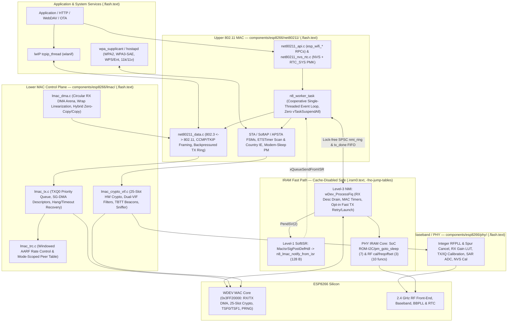
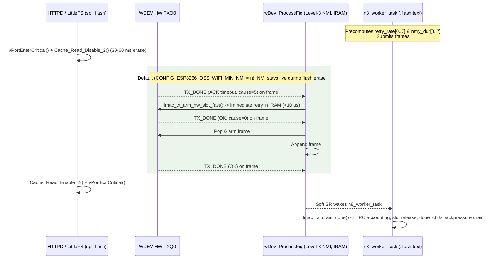
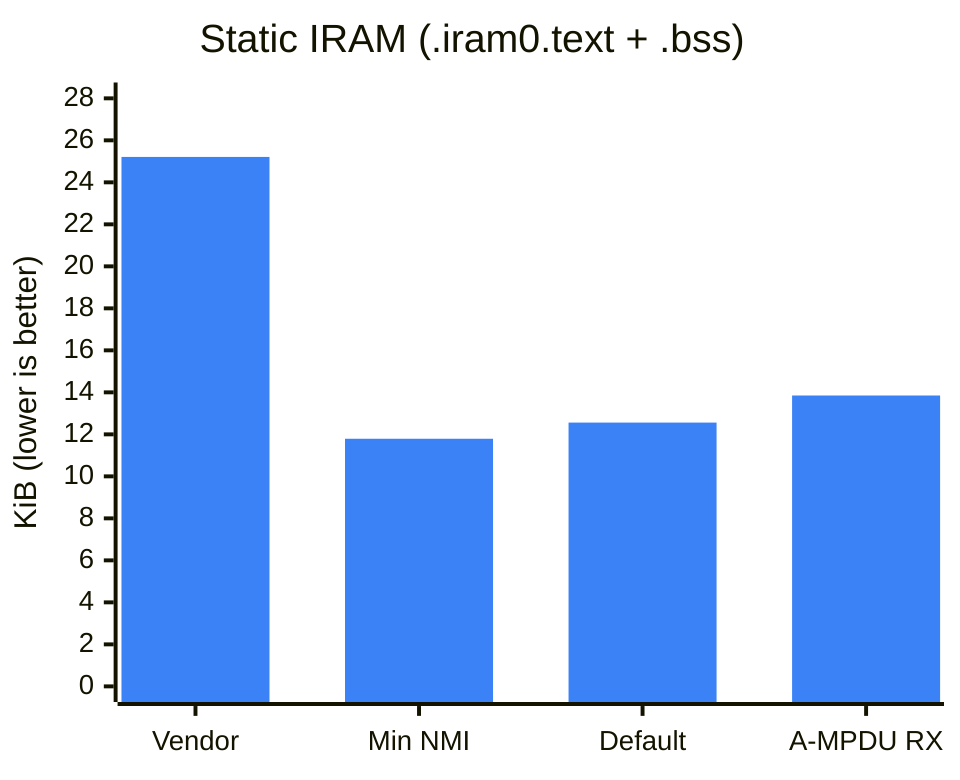
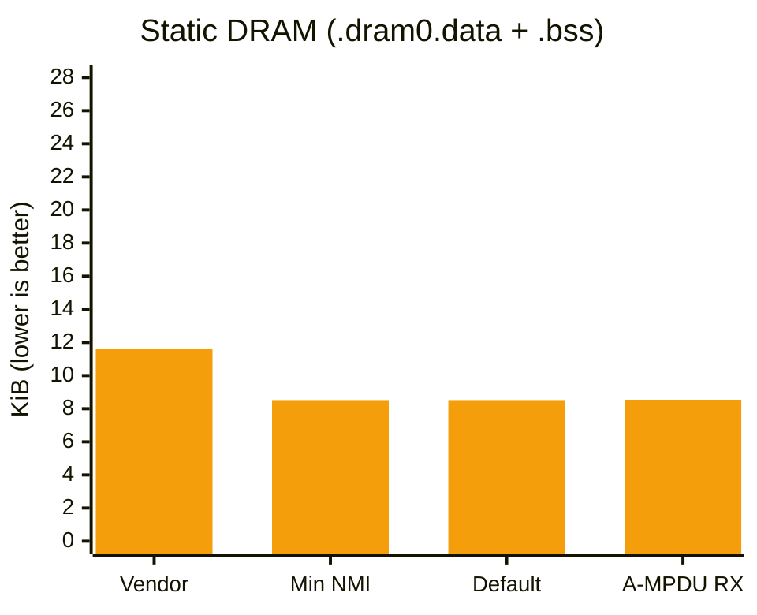

# ESP8266 Open-Source Wi-Fi Network Stack Architecture (`WIFI_DESIGN.md`)

Architectural overview of the clean-room open-source Wi-Fi stack in `components/esp8266/` replacing the proprietary `libphy.a`, `libpp.a` (`_dbg`), and `libnet80211.a` (`_dbg`) archives under `ESP8266_RTOS_SDK` (GCC 16.2).

For module-level provenance, licensing, and Kconfig toggles, see [OSS.md](OSS.md). For reproducible hardware benchmark instructions, see [test/WIFI_BENCHMARK.md](test/WIFI_BENCHMARK.md).

---

## 1. Architectural Goals & Key Differentiators

The open-source Wi-Fi stack preserves 100% source and ABI compatibility with `esp_wifi.h`, `tcpip_adapter` / lwIP (`wlanif`), and `wpa_supplicant` / `hostapd` (WPA2-PSK CCMP/TKIP, WPA3-SAE, always-on WPS & WPA2-Enterprise callback glue with `0 B` of `wps/*.o` / `eap_peer/*.o` linked when unused via `--gc-sections`, 802.11w PMF/BIP with SW CCMP + SA-Query, replay/A-MSDU/fragment guards, opt-in WMM/QoS via `ESP8266_WIFI_QOS_ENABLED`, opt-in A-MPDU RX via `ESP8266_WIFI_AMPDU_RX_ENABLED` across STA/SoftAP/Sniffer/WPA3, opt-in FragAttacks-hardened RX defragmentation via `ESP8266_OSS_WIFI_RX_DEFRAG_ENABLED`, SGI20 TX `65.0 -> 72.2 Mbps`, CSA IE 37 zero-disconnect channel hop + APSTA SoftAP resync, ERP IE 42 / HT Op IE 61 & retry-burst RTS/CTS protection, `CONFIG_WPA_11KV_SUPPORT` wiring returning `false` when `=n`, STA, SoftAP, APSTA, promiscuous sniffer with ctrl filter, `WIFI_PS_MIN_MODEM` / `WIFI_PS_MAX_MODEM` with TSF-synced µs wakeups, regulatory TX power clamping / SoftAP Country IE, and full `esp_wifi_*` API parity) while rethinking memory placement, concurrency, and hardware queue management around the constraints of the Xtensa LX106 (`32 KB` instruction RAM, `80 KB` DRAM, SPI flash XIP cache).

| Dimension | Vendor Blobs (`libphy` / `libpp` / `libnet80211`) | Open-Source Stack (`phy/` / `lmac/` / `net80211/`) | Key Benefit |
| :--- | :--- | :--- | :--- |
| **IRAM Placement** | Blanket `noflash_text` linker rules across `libphy.a` and `libpp.a` (`25,811 B` / `25.2 KB` total static IRAM) | Targeted `IRAM_ATTR` strictly on Level-3 NMI, SoftISR, and flash-disabled RF primitives (`12,863 B` / `12.6 KB` default with IRAM NMI fast TX; `12,075 B` / `11.8 KB` with [`OSS_WIFI_MIN_NMI=y`](#cfg-oss-wifi-min-nmi)) | **-50.2% to -53.2% static IRAM** (`-12,948 B` to `-13,736 B`), unlocking `77,280 B` (`+23.6%`) boot / `69,008 B` (`+34.9%`) `softap_prov` runtime heap vs. Vendor `62,508 B` / `51,168 B` |
| **Concurrency Model** | `ppT` task with scheduler-wide `__wifi_task_suspend_all()` (`vTaskSuspendAll`) critical regions | Single serialized cooperative worker (`n8_worker_task`) + lock-free SPSC NMI ring + brief `vPortETSIntrLock()` HW sections | **Zero scheduler freezes**; predictable RTOS & HTTP tail latency |
| **TX Queue Architecture** | Multi-queue hardware WDEV TX (`q=0..7`) with complex `lmac_check_ac` stall recovery | Serialized hardware `TXQ0` with FIFO-preserving software priority (`VO/MGMT/BCN` ahead of `VI/BE/BK`) + default IRAM NMI retry/launch | Eliminates multi-queue WDEV backoff lockups and cuts flash-erase contention stalls |
| **Rate Control (TRC)** | Proprietary closed rate table in `libpp.a` | Pure-integer windowed AARF (`lmac_trc.c`) over 11b/11g/HT20 MCS (`MCS7-SGI` `72.2 Mbps`) with non-linear per-packet retry fallback | High sustained throughput (`MCS7-SGI`) with rapid weak-link protection |
| **Key Derivation & Reconnect** | Synchronous PBKDF2 / association path; NVS-only credentials | Caller-task eager PBKDF2-SHA1 + [64-byte RTC_SYS warm-reboot PMK & channel cache](#cfg-oss-wifi-rtc-fast-connect) | **Zero worker stalls** during WPA2/WPA3 setup; ~1 s faster warm-reboot reconnect |
| **Memory Allocation** | Static worst-case SoftAP / connection-manager pools (`g_cnxMgr`, `1,224 B` always resident) | Mode-scoped SoftAP peer slab (allocated on AP start, freed on AP stop); zero `SHN_COMMON` globals | **-26.6% static DRAM** (`-3,156 B`, `8,724 B` vs. `11,880 B`) and **-14.7% to -14.9% flash binary** (`-85,664 B` to `-86,432 B`, `495,856 B` / `495,088 B` vs. `581,520 B`) |
| **RFPLL / Math Runtime** | Mixed soft-float & legacy GCC 5.2 codegen | 100% 64-bit integer fractional-N RFPLL synthesis, spur cancellation, and RTC clock scaling | **0 soft-float helpers** linked; clean GCC 16.2 `-Wall -Wextra -Werror` |

---

## 2. Layered System Architecture

The stack is partitioned into three strictly bounded layers—**RF/PHY (`phy/`)**, **Lower MAC (`lmac/`)**, and **Upper 802.11 MAC (`net80211/`)**—separated by clean C boundaries and a hard execution-context wall between **IRAM (safe while SPI flash cache is disabled)** and **Flash XIP (`.flash.text`)**.

---

## 3. Subsystem Design

### 3.1 RF / Baseband / PHY (`components/esp8266/phy/`)
- **Modularization (SoC `phy` vs. Wi-Fi `phy_rf`)**: Nine focused C modules partitioned into **SoC `phy`** (`CONFIG_ESP8266_OSS_PHY`: `phy_soc.c`, `phy_i2c_pbus.c`, `phy_clock.c`, `phy_adc.c`, `phy_sleep.c` — active in both `OSS_PHY_WIFI` and `OSS_PHY_ONLY`) and **Wi-Fi `phy_rf`** (`CONFIG_ESP8266_OSS_PHY_WIFI`: `phy_rf_chan.c`, `phy_rxgain.c`, `phy_cal_tx.c`, `phy_core.c`) export the full `48`-symbol cross-boundary PHY ABI (`g_phyFuns`, `esp_phy_init_data_t`, `phy_sleep_params_t`) guarded by compile-time `_Static_assert` checks.
- **Minimal IRAM Residency**: Only the **10 functions** invoked from Level-3 NMI or flash-disabled sleep transitions—7 in SoC `phy` (`rom_i2c_*`, `phy_get_mactime`, `clockgate_watchdog`, `pm_goto_sleep`) and 3 in Wi-Fi `phy_rf` (`phy_get_bb_evm`, `phy_fix_cache_bug`, `phy_get_bb_freqoffset`)—reside in IRAM; calibration, channel synthesis, and gain table construction stay in `.flash.text`.
- **Pure-Integer RF Synthesis**: Fractional-N sigma-delta RFPLL tuning, digital spur cancellation (`phy_change_channel`), and 64-bit RTC microsecond conversion (`pm_usec2rtc_64`) use strictly integer arithmetic, avoiding soft-float library overhead.
- **Calibration Persistence**: Full RF/IQ/TX-DC calibration runs on erased NVS and persists checksummed calibration data ([`CONFIG_ESP_PHY_CALIBRATION_AND_DATA_STORAGE`](#cfg-phy-calibration-storage)) for sub-millisecond warm-boot partial calibration reloads.

### 3.2 Lower MAC & WDEV Driver (`components/esp8266/lmac/`)
- **Strict Level-3 NMI Discipline (`lmac_nmi.c`)**:
  - `wDev_ProcessFiq` is compiled with `-fno-jump-tables` and audited via linked-ELF disassembly to guarantee **zero `.flash.text` calls and zero `.flash.rodata` literals** across all reachable callees (including `always_inline` MMIO accessors in `lmac_regs.h`).
  - Strictly preserves `_xt_nmi` / `port.c` invariants: `NMIIrqIsOn` nesting, `WDEV_TSF0_REACH_INT` (`BIT(27)`) priority for `task_wdt` NMI WDT, and clearing `DPORT` NMI enable (`0x3FF00000`) in the epilogue before `rfi 3`.
  - Bridges to the worker via a 32-entry lock-free single-producer/single-consumer ring (`nmi_ring`) and `PendSV(2)` -> `MacIsrSigPostDefHdl()`, plus a dynamically allocated 16-entry `snf_ring` (`0 B` heap when sniffer is off) populated on `LMAC_INT_SNIFFER_END` (`BIT(2)` without `BIT(8)`) after verifying `LMAC_WDEV_RX_STAT_INFO` (`0x00` or `0x41`), frame filters, and `LMAC_WDEV_RX_TSF_LO` / `INT_RAW` / post-copy header torn-read integrity so hardware-delivered `WIFI_PKT_CTRL` frames are captured before `rx_head->buf` is overwritten.
  - When [`CONFIG_ESP8266_WIFI_AMPDU_RX_ENABLED`](#cfg-wifi-ampdu-rx-enabled) is enabled (and `init_cfg.ampdu_rx_enable != 0`), `nmi_drain_rx()` demuxes hardware `rx_ampdu_descs` subframes in IRAM using a static 32-entry `lmac_rx_subframe_t` pool (zero `malloc` in NMI), drops fragmented A-MPDU subframes (`CVE-2020-26146`), tracks 5-bit `LLDESC_OFF_MASK` descriptor refcounts across shared `rx_descs`, immediately restores `LLDESC_OWNER` on `rx_ampdu_descs` and recycles unreferenced `rx_descs`, and supports sniffer-mode A-MPDU capture alongside `snf_ring`. When `=n`, all A-MPDU NMI paths compile out (`0 B` IRAM / `0 B` DRAM).
- **Circular RX DMA & Hybrid Ownership (`lmac_dma.c`)**:
  - Contiguous DRAM `hw_arena` ([`CONFIG_ESP8266_WIFI_RX_BUFFER_NUM`](#cfg-wifi-rx-buffer-num) up to `28` × `524 B` + arena-backed `rx_handles` + `1,076 B` or `1,600 B` wrap-linearization `extradata` + dummy A-MPDU descriptor, plus opt-in `rx_ampdu_descs`/`rx_ampdu_bufs`/`rx_subframes` only when `ampdu_rx_enable != 0`).
  - NMI claims completed `lldesc` chains in `< 10 µs` with zero heap allocation or `memcpy`; the worker strips the 4-byte FCS, calibrates RSSI (`raw - 96 dBm`), linearizes wrap-arounds into `extradata` (forcing heap-copy instead of zero-copy whenever a frame spans `extradata`), and applies a hybrid policy ([`CONFIG_ESP8266_WIFI_LEFT_CONTINUOUS_RX_BUFFER_NUM`](#cfg-wifi-left-continuous-rx-buffer-num))—zero-copy into lwIP when contiguous DMA headroom and free DRAM (`> 6 KB`) permit, otherwise heap-copying and immediately recycling DMA descriptors (decrementing 5-bit shared-descriptor refcounts under `vPortETSIntrLock()` when A-MPDU RX is enabled).
- **Serialized Hardware `TXQ0` & Scatter-Gather DMA (`lmac_tx.c`)**:
  - All access categories, management frames, and SoftAP beacons serialize onto hardware **`TXQ0`** (`0x3FF20DC0..0x3FF20DD4`), while software queue insertion maintains strict FIFO-within-priority (`VO / MGMT / BEACON` ahead of `VI / BE / BK`). This avoids ESP8266 WDEV multi-queue backoff lockups (`q=2` freeze under `q=0` contention) and `q=4`/`q=7` timeout strobes.
  - Up to 4 `12 B` DMA descriptors per TX slot (`hdr_buf` + 2 read-only DRAM payload segments + `trailer_buf` for MIC/ICV/FCS; pool sized by [`CONFIG_ESP8266_WIFI_TX_PKT_NUM`](#cfg-wifi-tx-pkt-num)) transmit lwIP `pbuf` payloads without mutating or copying frame bodies.
- **Windowed AARF Transmit Rate Control (`lmac_trc.c`)**:
  - Pure-integer rate adaptation over 11b / 11g / HT20 MCS schedules (`MCS7` initial rate under [`CONFIG_WIFI_TX_RATE_SEQUENCE_FROM_HIGH`](#cfg-wifi-tx-rate-sequence-from-high) with `< -80 dBm` weak-link initial clamp), **SGI20 TX promotion (`LMAC_RATE_HT_MCS7_SGI` `0x1F`, `72.2 Mbps`)** across `MCS5..7` when `pcaps.short_gi_20` (`LMAC_PEER_FLAG_SGI20`) is negotiated (`configure_peer_schedule()` starts at `MCS7` LGI / `MCS4` and promotes into SGI after a clean window), and directional RSSI EWMA rounding to prevent downward convergence stalls.
  - Evaluates 16-frame or `100 ms` windows (step-up at `<= 12.5%` retry ratio with AARF exponential probe hold `1 -> 2 -> 4 -> 8`; step-down at `>= 1.25` retry-equivalent/frame; emergency fast drop on consecutive failures/heavy retries) plus non-linear per-packet retry fallback `{0, 0, 1, 2, 4, 6, 8}`.
- **Hardware Crypto, Dual-VIF Filtering, RX BA & Beacons (`lmac_crypto_vif.c`)**:
  - Manages all 25 hardware key slots (`0x3FF21400`, supporting WEP, TKIP, CCMP for STA + SoftAP PTK/GTK) with transparent software CCMP/BIP fallback, 4-session deduplicated hardware RX Block Ack scoreboards (`esp_lmac_{can_add,add,del}_rx_ba()` with `peer_remove`/`vif_disable` cleanup), dual hardware MAC/BSSID filters, scan wildcard mode (`RX_FILTER_CTRL` bit 4), TSF1 TBTT SoftAP beacons, promiscuous sniffer capture, and 5-bank hardware MAC reset recovery.

### 3.3 IRAM NMI Fast TX Path (Default-Enabled; Disabled via [`CONFIG_ESP8266_OSS_WIFI_MIN_NMI`](#cfg-oss-wifi-min-nmi))
During SPI flash operations (`spi_flash_erase_sector` taking `30–60 ms`, or `spi_flash_read` bursts), ESP8266 disables the SPI flash XIP cache (`Cache_Read_Disable_2`) and masks Level-1 interrupts, pausing all `.flash.text` tasks while **Level-3 NMI (`wDev_ProcessFiq`) remains live in IRAM**.

- **Default Fast Path ([`OSS_WIFI_MIN_NMI=n`](#cfg-oss-wifi-min-nmi))**: Costs **`+789 B` IRAM** (`2,827 B` vs. `2,038 B` in `lmac_nmi.o`; `+0 B` static DRAM; `+928 B` dynamic heap for a [10-slot TX pool floor](#cfg-wifi-tx-pkt-num)) while retaining **`-12,948 B` (`12.6 KB`, `-50.2%`)** static IRAM savings over Vendor Blobs (`10,258 B` saved in `lmac_nmi.o` vs. `libpp.a`'s `13,085 B`).
- **Minimal NMI Mode ([`CONFIG_ESP8266_OSS_WIFI_MIN_NMI=y`](#cfg-oss-wifi-min-nmi))**: Compiles out all fast-TX struct fields, lock paths, and IRAM helpers via `#ifndef CONFIG_ESP8266_OSS_WIFI_MIN_NMI`, reclaiming those `789 B` (`-13,736 B` / `13.4 KB` / `-53.2%` static IRAM vs. Vendor Blobs).
- **Leak-Free NMI → Worker Handoff**: Completed slots are linked via `slot->next` onto a coalesced `tx_done_head`/`tx_done_tail` FIFO protected against task access with `vPortETSIntrLock()`, consuming `0` `nmi_ring` entries so RX bursts during long flash erases can never drop TX completions.

### 3.4 Upper 802.11 MAC (`components/esp8266/net80211/`)
- **Cooperative Single-Task Worker (`net80211_worker.c`)**: Runs all upper-MAC state machines, bounded LMAC RX/TX batch drains (`16/16`), bounded `ets_timer_proc_one()` callbacks, synchronous `esp_wifi_*` RPCs (`n8_api_call()` marshaling across all mutating config/MAC/protocol/TX-power/vendor-IE/PM APIs), `init_cfg.event_handler` system-event dispatch (with `esp_event_send` fallback), and 100 ms housekeeping on one serialized task ([`CONFIG_ESP8266_OSS_WIFI_TASK_PRIO=13`](#cfg-oss-wifi-task-prio), stack sized by [`CONFIG_WIFI_PPT_TASKSTACK_SIZE`](#cfg-wifi-ppt-taskstack-size)) with critical-section signal coalescing flags (`lmac_evt_queued`, `tx_evt_queued`, `timer_evt_queued`) and **zero `vTaskSuspendAll()` calls**.
- **Backpressured Data Plane, QoS DSCP→TID/AC, RTS/CTS Protection, Replay Window, EAPOL Routing & Cipher Guards (`net80211_data.c`, `lmac_tx.c`)**: Power-of-two 16-entry `tx_jobs` ring between `tcpip_thread` and `n8_worker_task` checks `esp_lmac_tx_has_free_slot()` before advancing 802.11 sequence numbers or CCMP/TKIP packet numbers, and pauses STA data TX (`sta_csa_tx_paused`) while a CSA quiet-mode switch is pending. When [`CONFIG_ESP8266_WIFI_QOS_ENABLED`](#cfg-wifi-qos-enabled) (or `ampdu_rx_enable`) is active and the link negotiated WMM/HT, IPv4 DSCP (`eth[15] >> 2`) maps to 802.11 UP/TID `0..7` and LMAC Access Category (`AC_VO`/`VI`/`BE`/`BK`), while EAPOL remains non-QoS on `AC_VO` and `QOS=n` emits 24-byte `0x08` non-QoS frames. For frames `>= 256 B`, sets `ESP_LMAC_TX_FLAG_USE_RTS` whenever ERP/HT protection (`sta_erp_prot != 0`) or sustained heavy TX retries (`sta_tx_retry_burst >= 3` on `st->retries >= 4` / failure) require RTS/CTS protection. On RX, accepts both QoS (`0x88`) and non-QoS (`0x08`), enforces a 64-packet sliding-window PN/TSC replay check with per-TID deduplication (`TID 0..7` + non-QoS `TID 8`), drops unencrypted data (`CVE-2020-26140`) and plaintext EAPOL frames once a PTK is installed, validates `N8_EAPOL_HDR_LEN` (`>= 4 B`) before EAPOL dispatch (splitting WPS pending frames to `wps_sm_rx_eapol`, non-`EAPOL_KEY` WPA2-Enterprise frames to `wpa2_sm_rx_eapol`, and 4-way `EAPOL_KEY` frames to `wpa_sta_rx_eapol`), and rejects A-MSDU (`QoS & 0x80`) and fragmented data MPDUs (`MoreFrag` / `FragNum > 0`) by default. For TKIP, WDEV hardware performs RX Michael MIC verification (`rxend_state = 0xF5`, raising supplicant MIC-failure countermeasures / reason `14` on mismatch) and **computes TKIP TX Michael MIC in hardware** (**Live-Silicon Check #1 Outcome A**: confirmed identical over-the-air MIC tail bytes with zero SW MIC pre-computation, eliminating the redundant SW TX Michael MIC pass). In `lmac_tx.c`, encrypted submissions verify a valid HW key slot before allocating a TX slot (`ESP_ERR_NOT_FOUND` on missing key), while software-encrypted frames (`Protected=1`, `cipher=NONE`, e.g., PMF Action/Deauth) steer `hw_key_slot` to the inactive/bypassed opposite VIF and temporarily mask `LMAC_CRYPTO_TX_ENC` when APSTA has both VIFs active so WDEV never double-encrypts, and `hw_crypto_update_vif_reg()` preserves `LMAC_CRYPTO_TX_ENC` across opposite-VIF `BYPASS -> key_set` transitions whenever a software-protected frame is active on `hw_txq[]`.
- **Fast-Connect & Eager Key Derivation (`net80211_nvs_rtc.c`)**: Derives WPA2-PSK PBKDF2-SHA1 eagerly on the caller's task inside `esp_wifi_set_config()` and caches the resulting 32-byte PMK + channel in `64 B` of `RTC_SYS` memory ([`CONFIG_ESP8266_OSS_WIFI_RTC_FAST_CONNECT`](#cfg-oss-wifi-rtc-fast-connect), defaulting to `y` when [`CONFIG_ESP8266_WIFI_NVS_ENABLED`](#cfg-wifi-nvs-enabled) is `n`), enabling warm-reboot STA reconnect in `< 1 s` without blocking the Wi-Fi worker.
- **Associated Scanning, WPS Scan Glue, Open-AP Guard, Regulatory Power & LNA Guard (`net80211_scan.c`, `net80211_sta.c`, `net80211_pm.c`)**: Adopts the connected AP's 802.11d Country IE (`WIFI_COUNTRY_POLICY_AUTO`), clamps `phy_set_most_tpw()` to `min(PHY_MAX_WIFI_TX_POWER * 4, active_country->max_tx_power * 4, user_max_tx_power)`, drives close-range `chip_v6_rxmax_ext(3U)` with 5 dB hysteresis (`> -25 dBm` / `< -30 dBm`) across `esp_lmac_set_channel()` resets, extracts `ht_sgi20` (`HT Cap Info & 0x20U`) alongside HT20 MCS capabilities, classifies `SUPP_KEY_MGMT_IEEE8021X | SUPP_KEY_MGMT_IEEE8021X_SHA256` APs as `WIFI_AUTH_WPA2_ENTERPRISE`, enforces [`CONFIG_ESP8266_WIFI_CONNECT_OPEN_ROUTER_WHEN_PWD_IS_SET`](#cfg-wifi-connect-open-router-when-pwd-is-set) and `sta.sort_method` (`BY_SIGNAL` / `BY_SECURITY`) during STA AP selection (permitting empty-password candidate selection for pending WPS and registered WPA2-Enterprise), drives [active/passive multi-channel scanning](#cfg-scan-ap-max) (bounded by [`CONFIG_SCAN_AP_MAX`](#cfg-scan-ap-max)) plus callback-driven `esp_wifi_promiscuous_scan_start()` for WPS (`WIFI_APPIE_WPS_PR` ProbeReq append and `wps_parse_scan_result()` forwarding across `WPS_STATUS_DISABLE`/`WPS_STATUS_SCANNING` before scan-table deduplication) with `ETSTimer` (`120 ms` active dual-probe / `360 ms` passive, scatter-gather ProbeReq when IEs exceed 92 B, early exit on directed connect match), pauses off-channel STA data TX, and interleaves `20 ms` home-channel `PM=0` windows so active TCP/HTTP sessions stay responsive during scans.
- **802.11w PMF, Block Ack RX, Optional Defragmentation, WPS/WPA2-Ent Hooks, SGI20 / CSA / ERP / 11k-11v, WMM IEs, Public APIs, SoftAP & TSF-Synced Modem Sleep (`net80211_sta.c`, `net80211_ap.c`, `net80211_defrag.c`, `net80211_pm.c`, `net80211_supp_glue.c`, `net80211_api.c`)**: Implements software `ccmp_encrypt`/`ccmp_decrypt` for robust management frames (`Deauth`/`Disassoc`/Robust Action) alongside BIP-CMAC-128 verification for broadcast/multicast robust frames, enforces PMF `mfp=2` (`WIFI_REASON_NO_AP_FOUND` when connecting to non-PMF APs), and runs `200 ms` retry / `1000 ms` timeout SA-Query recovery on unprotected Deauth/Disassoc while associated. Provides always-on WPS and WPA2-Enterprise callback glue (`n8_api_call`-marshaled `wps_cb` / `wpa2_cb` / `esp_wifi_sta_wpa2_ent_{enable,disable}_internal`, leak-free cleanup in `esp_wifi_deinit_internal()`, `WIFI_APPIE_WPS_AR` open-auth association + `wps_start_pending()` + `esp_wifi_disarm_sta_connection_timer_internal()`, and `WPA2_AUTH_ENT` RSN IE + `sta_reset_param = 0U` + `wpa2_{init,start,deinit}()` with a `30 s` `N8_STA_4WAY` timeout) while letting `--gc-sections` strip `wps/` and `eap_peer/` objects (`0 B`) whenever unused. Propagates `pcaps.short_gi_20` on both STA and SoftAP peers for `72.2 Mbps` `MCS7-SGI` TX; parses Channel Switch Announcement IE 37 (`mode`, `new_ch`, `count`) to execute zero-disconnect regulatory-validated channel hops (`esp_lmac_set_channel()`, `sta_rxmax_ext_state` restore, `n8_ap_sync_channel()` APSTA SoftAP resync, and `100 ms` missed-beacon countdown fallback); tracks ERP IE 42 (`0x02U`) and HT Op IE 61 (`val[2] & 0x03U`) into `sta_erp_prot`; and wires [`CONFIG_WPA_11KV_SUPPORT`](#cfg-wpa-11kv-support) (`esp_wifi_is_{rm,btm}_enabled_internal()` returning `false` when `=n`, `esp_wifi_register_frame_internal()`, `WIFI_APPIE_RM_ENABLED_CAPS` IE 70 + `0x1000U` capability bit in `sta_send_assoc_req()`, `n8_api_call`-marshaled `esp_wifi_send_mgmt_frm_internal()` -> `n8_sta_tx_action()`, and `esp_sta_rx_mgmt(stype_idx, post_24B_payload, ...)` forwarding for Beacon/ProbeResp/Action). When [`CONFIG_ESP8266_WIFI_AMPDU_RX_ENABLED`](#cfg-wifi-ampdu-rx-enabled) is enabled (and `init_cfg.ampdu_rx_enable != 0`), both STA (including WPA3-SAE + PMF links) and SoftAP negotiate Category 3 `ADDBA Request` / `ADDBA Response` and `DELBA` across the shared 4-session LMAC scoreboard, deferring `esp_lmac_add_rx_ba()` until `ADDBA Response` TX-done reports `st->ok != 0` while relying on lwIP TCP `OOSEQ` + P1's 64-pkt sliding replay window (no DRAM BA reorder buffer). When [`CONFIG_ESP8266_OSS_WIFI_RX_DEFRAG_ENABLED`](#cfg-oss-wifi-rx-defrag-enabled) is enabled, `net80211_defrag.c` reassembles fragmented data MSDUs in a bounded 2-slot heap-on-demand table (`2 s` timeout, key/disconnect purge) with FragAttacks hardening (`CVE-2020-26142..26146`: no multicast/A-MSDU fragments, contiguous `frag_num`, matching `(is_prot, cipher, 2-bit key_idx)`, and consecutive `PN[i] == PN[i-1] + 1` for CCMP/TKIP). Negotiates WMM Info/Parameter IEs on STA and SoftAP, emits SoftAP Country IE (ID 7), supports `esp_wifi_set_rssi_threshold()` (`SYSTEM_EVENT_STA_BSS_RSSI_LOW`), `esp_wifi_set_authmode` / `SYSTEM_EVENT_STA_AUTHMODE_CHANGE`, lazy-allocated vendor IE TX/RX (`esp_wifi_set_vendor_ie{,_cb}`), promiscuous ctrl-subtype filtering, `esp_wifi_set_sta_rx_probe_req()`, `esp_wifi_sta_get_ap_info()` (`wps`/`phy_11b`/`phy_11g`/`freq_offset`/active country), and `esp_wifi_{set,get}_pm_config()`. Allocates the SoftAP station peer slab strictly while SoftAP is running and frees it completely on stop; synchronizes `esp_wifi_get_tsf_time()` against connected AP beacon TSF (`sta_tsf_diff_us` via 64-bit `esp_lmac_get_tsf_us()`) and drives `WIFI_PS_MIN_MODEM` / `WIFI_PS_MAX_MODEM` (`listen_interval` multiplier + TSF-aligned one-shot µs `pm_wake_timer`) in pure-STA mode.

---

## 4. Memory & Binary Footprint Comparison

Measured on `ESPZWApplianceT2` (`esp01_4m`, GCC 16.2, release `-Os`, full STA + SoftAP + WPA2/WPA3-SAE + lwIP + mbedTLS + HTTP/WebDAV + LittleFS + dual-slot OTA; all P1–P5 features active, `CONFIG_WPA_11KV_SUPPORT=n`, `0` compiler warnings, `0` vendor blobs in OSS builds):

<table><tr><td width="480">

</td><td width="480">

</td></tr></table>

*(Left: Static IRAM `.iram0.text + .bss`; Right: Static DRAM `.dram0.data + .bss`. Both charts share the same `0–28 KiB` scale.)*

### Static ELF & Binary Footprint

| Memory Metric (bytes, lower is better) | Vendor Blobs | OSS Minimal NMI ([`OSS_WIFI_MIN_NMI=y`](#cfg-oss-wifi-min-nmi)) | OSS Default ([`OSS_WIFI_MIN_NMI=n`](#cfg-oss-wifi-min-nmi)) | OSS A-MPDU RX (`n=28, win=6`) ([`AMPDU_RX_ENABLED=y`](#cfg-wifi-ampdu-rx-enabled)) |
| :--- | ---: | ---: | ---: | ---: |
| `bootloader.bin` (B) | `9,872` | `9,872` (`+0.0%`) | `9,872` (`+0.0%`) | `9,872` (`+0.0%`) |
| **Static IRAM** (`.iram0.text + .bss`, B) | `25,811` | `12,075` ($`\color{green}{-53.2\%}`$, `-13,736 B`) | `12,863` ($`\color{green}{-50.2\%}`$, `-12,948 B`) | `14,187` ($`\color{green}{-45.0\%}`$, `-11,624 B`) |
| **Static DRAM** (`.dram0.data + .bss`, B) | `11,880` | `8,724` ($`\color{green}{-26.6\%}`$, `-3,156 B`) | `8,724` ($`\color{green}{-26.6\%}`$, `-3,156 B`) | `8,740` ($`\color{green}{-26.4\%}`$, `-3,140 B`) |
| **Flash Code + Rodata** (`.flash.text + .rodata`, B) | `558,368` | `484,844` ($`\color{green}{-13.2\%}`$, `-73,524 B`) | `484,824` ($`\color{green}{-13.2\%}`$, `-73,544 B`) | `484,824`[\*a](#note-ampdu-flash) ($`\color{green}{-13.2\%}`$, `-73,544 B`) |
| **Firmware Binary** (`firmware.bin`, B) | `581,520` | `495,088` ($`\color{green}{-14.9\%}`$, `-86,432 B`) | `495,856` ($`\color{green}{-14.7\%}`$, `-85,664 B`) | `497,184` ($`\color{green}{-14.5\%}`$, `-84,336 B`) |

*(\*aRelative to OSS Default, `OSS A-MPDU RX` adds `+1,324 B` static IRAM, `+16 B` static DRAM, `+1,328 B` `firmware.bin`, and `+2,591 B` to `libesp8266.a` `.flash.text` (which fits inside existing 4 KB `.flash.text` alignment slack before `.flash.rodata`, so total `.flash.text` remains `421,872 B` and `.flash.rodata` remains `62,952 B`).)*

### Runtime Heap Watermarks

Measured on live hardware via `-DZW_FOOTPRINT_PROBE` (`+56 B` static DRAM / `+812 B` Flash instrumentation overhead vs. clean production builds above). All deltas are relative to **Vendor Blobs** ($`\color{green}{\text{green}}`$ = more free heap, $`\color{red}{\text{red}}`$ = less free heap):

| State | Metric (bytes, higher is better) | Vendor Blobs | OSS Minimal NMI (vs. Vendor) | OSS Default (vs. Vendor) | OSS A-MPDU RX (`n=28, win=6`) (vs. Vendor) |
| :--- | :--- | ---: | ---: | ---: | ---: |
| `boot` | `free_heap` / `min_free_heap` | `62,508` / `62,112` | `79,096` ($`\color{green}{+26.5\%}`$) / `78,920` ($`\color{green}{+27.1\%}`$) | `77,280` ($`\color{green}{+23.6\%}`$) / `77,104` ($`\color{green}{+24.1\%}`$) | `66,404` ($`\color{green}{+6.2\%}`$) / `66,228` ($`\color{green}{+6.6\%}`$) |
| `boot` | `free_8bit` / `min_free_8bit` | `39,308` / `38,912` | `42,156` ($`\color{green}{+7.2\%}`$) / `41,980` ($`\color{green}{+7.9\%}`$) | `41,128` ($`\color{green}{+4.6\%}`$) / `40,952` ($`\color{green}{+5.2\%}`$) | `31,576` ($`\color{red}{-19.7\%}`$) / `31,400` ($`\color{red}{-19.3\%}`$) |
| `sta_idle` | `free_heap` / `min_free_heap` | `56,608` / `52,144` | `76,500` ($`\color{green}{+35.1\%}`$) / `72,036` ($`\color{green}{+38.1\%}`$) | `74,696` ($`\color{green}{+32.0\%}`$) / `70,012` ($`\color{green}{+34.3\%}`$) | `63,816` ($`\color{green}{+12.7\%}`$) / `59,364` ($`\color{green}{+13.8\%}`$) |
| `sta_idle` | `free_8bit` / `min_free_8bit` | `33,408` / `28,944` | `39,560` ($`\color{green}{+18.4\%}`$) / `35,096` ($`\color{green}{+21.3\%}`$) | `38,544` ($`\color{green}{+15.4\%}`$) / `33,860` ($`\color{green}{+17.0\%}`$) | `28,988` ($`\color{red}{-13.2\%}`$) / `24,536` ($`\color{red}{-15.2\%}`$) |
| `sta_http_load` | `free_heap` / `min_free_heap` | `56,276` / `45,352` | `76,184` ($`\color{green}{+35.4\%}`$) / `64,724` ($`\color{green}{+42.7\%}`$) | `74,528` ($`\color{green}{+32.4\%}`$) / `64,568` ($`\color{green}{+42.4\%}`$) | `63,572` ($`\color{green}{+13.0\%}`$) / `52,796` ($`\color{green}{+16.4\%}`$) |
| `sta_http_load` | `free_8bit` / `min_free_8bit` | `33,076` / `22,152` | `39,244` ($`\color{green}{+18.6\%}`$) / `27,784` ($`\color{green}{+25.4\%}`$) | `38,376` ($`\color{green}{+16.0\%}`$) / `28,416` ($`\color{green}{+28.3\%}`$) | `28,744` ($`\color{red}{-13.1\%}`$) / `17,968` ($`\color{red}{-18.9\%}`$) |
| `softap_prov` | `free_heap` / `min_free_heap` | `51,168` / `44,844` | `70,832` ($`\color{green}{+38.4\%}`$) / `64,724` ($`\color{green}{+44.3\%}`$) | `69,008` ($`\color{green}{+34.9\%}`$) / `62,896` ($`\color{green}{+40.3\%}`$) | `58,136` ($`\color{green}{+13.6\%}`$) / `52,028` ($`\color{green}{+16.0\%}`$) |
| `softap_prov` | `free_8bit` / `min_free_8bit` | `27,968` / `21,644` | `33,892` ($`\color{green}{+21.2\%}`$) / `27,784` ($`\color{green}{+28.4\%}`$) | `32,856` ($`\color{green}{+17.5\%}`$) / `26,744` ($`\color{green}{+23.6\%}`$) | `23,308` ($`\color{red}{-16.7\%}`$) / `17,200` ($`\color{red}{-20.5\%}`$) |

---

## 5. End-to-End Performance A/B Comparison

Measured back-to-back on identical ESP8266 hardware (160 MHz, 4 MB flash, `ESPZWApplianceT2` P5 base firmware) using [`test/wifi_benchmark.py`](test/wifi_benchmark.py) (`--runs 7`, 5-of-7 trimmed `mean ± stdev`). All deltas are relative to **Vendor Blobs** ($`\color{green}{\text{green}}`$ = better, $`\color{red}{\text{red}}`$ = worse); cells where either build's mean falls within the other's $`\pm 1\sigma`$ range ($`|\mu_{\text{oss}} - \mu_{\text{vendor}}| \le \max(\sigma_{\text{oss}}, \sigma_{\text{vendor}})`$) are marked **`on par`**.

| Metric (unit, lower/higher is better) | Vendor Blobs | OSS Minimal NMI ([`OSS_WIFI_MIN_NMI=y`](#cfg-oss-wifi-min-nmi)) | OSS Default ([`OSS_WIFI_MIN_NMI=n`](#cfg-oss-wifi-min-nmi)) | OSS A-MPDU RX (`n=28, win=6`) ([`AMPDU_RX_ENABLED=y`](#cfg-wifi-ampdu-rx-enabled)) |
| :--- | ---: | ---: | ---: | ---: |
| Warm Reboot -> HTTP Ready[\*2](#note-warm-reboot) (ms, lower is better) | 3159.57 ± 11.06 | 2375.86 ± 446.88 ($`\color{green}{-24.8\%}`$) | 2380.12 ± 434.45 ($`\color{green}{-24.7\%}`$) | 2578.15 ± 532.10 ($`\color{green}{-18.4\%}`$) |
| Modem-Sleep Wake Latency (5 s idle)[\*1](#note-fast-tx) (ms, lower is better) | 113.07 ± 8.02 | 153.69 ± 24.03 ($`\color{red}{+35.9\%}`$) | 114.29 ± 10.88 (on par) | 109.78 ± 14.98 (on par) |
| Active Wi-Fi Scan (APSTA) (ms, lower is better) | 1813.20 ± 9.85 | 1711.40 ± 19.82 ($`\color{green}{-5.6\%}`$) | 1738.45 ± 10.96 ($`\color{green}{-4.1\%}`$) | 1729.60 ± 18.75 ($`\color{green}{-4.6\%}`$) |
| Idle ICMP RTT (32 B, p50) (ms, lower is better) | 4.93 ± 0.30 | 5.72 ± 0.11 ($`\color{red}{+16.1\%}`$) | 5.74 ± 0.43 ($`\color{red}{+16.6\%}`$) | 5.67 ± 0.15 ($`\color{red}{+15.0\%}`$) |
| Fragmented ICMP Burst (5800 B, 4-frag)[\*3](#note-ampdu-rx) (pps, higher is better) | 33.31 ± 3.67 | 26.70 ± 1.13 ($`\color{red}{-19.8\%}`$) | 23.71 ± 5.90 ($`\color{red}{-28.8\%}`$) | 32.25 ± 2.98 (on par) |
| Heavy-MTU Saturation (4w x 100 @ 1400 B)[\*3](#note-ampdu-rx) (pps, higher is better) | 178.45 ± 34.15 | 197.32 ± 26.52 (on par) | 194.14 ± 10.80 (on par) | 223.89 ± 12.95 ($`\color{green}{+25.5\%}`$) |
| Heavy-MTU Saturation Tail p99 (4w @ 1400 B)[\*1](#note-fast-tx) (ms, lower is better) | 84.46 ± 17.79 | 85.07 ± 12.36 (on par) | 75.41 ± 20.87 (on par) | 74.98 ± 11.40 (on par) |
| Uncontested Downlink (1 MB flash read) (KB/s, higher is better) | 161.72 ± 29.22 | 148.44 ± 9.66 (on par) | 159.40 ± 6.83 (on par) | 162.89 ± 7.62 (on par) |
| Flash-Read Contended Downlink (1 MB + 1400 B)[\*3](#note-ampdu-rx) (KB/s, higher is better) | 175.38 ± 14.31 | 159.18 ± 10.69 ($`\color{red}{-9.2\%}`$) | 133.85 ± 15.02 ($`\color{red}{-23.7\%}`$) | 124.97 ± 21.61 ($`\color{red}{-28.7\%}`$) |
| WebDAV Storage Write (128 KB PUT) (KB/s, higher is better) | 70.95 ± 1.62 | 67.29 ± 7.87 (on par) | 72.35 ± 2.00 (on par) | 73.24 ± 2.76 (on par) |
| WebDAV Storage Read (128 KB GET) (KB/s, higher is better) | 109.17 ± 18.66 | 93.14 ± 42.52 (on par) | 113.98 ± 13.50 (on par) | 112.22 ± 7.68 (on par) |
| Flash-Erase Contention Probe p95 (PUT + 32 B) (ms, lower is better) | 49.35 ± 11.45 | 49.21 ± 12.21 (on par) | 49.29 ± 7.62 (on par) | 50.58 ± 4.35 (on par) |
| Flash-Erase Contention Stalls >40 ms (PUT + 32 B) (%, lower is better) | 10.52 ± 4.91 | 8.28 ± 4.67 (on par) | 8.53 ± 2.32 (on par) | 10.42 ± 0.91 (on par) |
| Flash-Erase Burst Contention PUT (PUT + 4200 B)[\*1](#note-fast-tx) (KB/s, higher is better) | 61.95 ± 3.50 | 51.23 ± 9.22 ($`\color{red}{-17.3\%}`$) | 62.92 ± 4.13 (on par) | 63.28 ± 1.57 (on par) |
| Flash-Erase Burst Contention Probe p95 (+4200 B)[\*1](#note-fast-tx) (ms, lower is better) | 76.07 ± 17.80 | 134.00 ± 39.39 ($`\color{red}{+76.2\%}`$) | 87.82 ± 19.84 (on par) | 77.82 ± 12.62 (on par) |
| Concurrent HTTP Close (6w x 25 /!sys/discover)[\*3](#note-ampdu-rx) (req/s, higher is better) | 33.13 ± 2.03 | 34.43 ± 1.25 (on par) | 33.34 ± 1.29 (on par) | 37.16 ± 1.16 ($`\color{green}{+12.2\%}`$) |
| Concurrent HTTP Keep-Alive (4w x 40 boot_serial) (req/s, higher is better) | 43.30 ± 2.14 | 46.79 ± 1.48 ($`\color{green}{+8.1\%}`$) | 44.18 ± 0.77 (on par) | 45.26 ± 2.25 (on par) |

*(All values are 5-of-7 trimmed means ± stdev from matched back-to-back sessions on live 2.4 GHz air; `0` HTTP errors across all runs.)*

### Performance Notes

- **[\*1] Default Fast TX Recovery (`Modem-Sleep Wake` & `Flash-Erase Burst Contention` restored to `on par`; `Heavy-MTU Tail p99` `on par` across all OSS builds)**: Under [`OSS_WIFI_MIN_NMI=y`](#cfg-oss-wifi-min-nmi), deferring TX retries and next-slot launches to the `.flash.text` worker degrades `Modem-Sleep Wake` (`153.69 ms`, `+35.9%`) and `Flash-Erase Burst Contention` (`51.23 KB/s`, `-17.3%` PUT; `134.00 ms`, `+76.2%` probe p95 across `30–60 ms` `Cache_Read_Disable_2` windows). Enabling the default IRAM NMI fast TX path (`+789 B` IRAM) cuts `Modem-Sleep Wake` by **`-25.6%`** (`114.29 ms`), lifts `Flash-Erase Burst` PUT by **`+22.8%`** (`62.92 KB/s`), and cuts its probe p95 by **`-34.5%`** (`87.82 ms`), bringing both back **`on par`** with Vendor Blobs (`Heavy-MTU Saturation Tail p99` also stays **`on par`** across all OSS builds).
- **[\*2] Warm Reboot Quantization Variance (`-18.4%` to `-24.8%` mean, `±434–532 ms` stdev)**: All three OSS builds reconnect ~`580–780 ms` faster on average than Vendor Blobs (`2375.86–2578.15 ms` vs. `3159.57 ms`) via `RTC_SYS` PMK caching, while the `±434–532 ms` stdev arises from discrete `+1000 ms` beacon/DHCP retry quantization (`~2.17 s` on 4–5/7 runs vs. `~3.16 s` on 2–3/7 runs, `0` HTTP errors).
- **[\*3] `Fragmented ICMP Burst` (`-28.8%` Default) & `Flash-Read Contended Downlink` (`-23.7%` Default) vs. `AMPDU_RX_ENABLED=y` Recovery**: Without A-MPDU RX aggregation, multi-fragment burst RX and flash-read-contended downlink share single-MPDU worker/DMA drains (`-19.8% to -28.8%` Frag ICMP, `-9.2% to -23.7%` Contended Downlink). Enabling opt-in [`ESP8266_WIFI_AMPDU_RX_ENABLED=y`](#cfg-wifi-ampdu-rx-enabled) (`RX_BUFFER_NUM=28`, `RX_BA_WIN_SIZE=6`, auto-selecting `QOS_ENABLED=y`) boosts `Fragmented ICMP Burst` by **`+36.0%`** over OSS Default (`32.25 pps`, **`on par`** with Vendor), lifts `Heavy-MTU Saturation` by **`+15.3%`** over OSS Default (`223.89 pps`, **`+25.5%`** over Vendor), and lifts `Concurrent HTTP Close` by **`+11.5%`** over OSS Default (`37.16 req/s`, **`+12.2%`** over Vendor).

---

## 6. Kconfig & Tuning Options

For top-level `Open-Source / Vendor Blob Selection` choices (`ESP8266_PHY_WIFI_IMPL`, hidden derived `ESP8266_OSS_PHY`, `ESP8266_HAL_IMPL`, `ESP8266_CORE_IMPL`, and `sdkconfig.defaults` notes), see [OSS.md §3](OSS.md#3-consumer-kconfig-reference). Under `CONFIG_ESP8266_OSS_PHY_ONLY=y`, `menu Wi-Fi` and the 3 Wi-Fi-RF `menu PHY` prompts are hidden while keeping `ESP_PHY_INIT_DATA_VDD33_CONST` visible for SAR ADC / VDD33.

### 6.1 OSS-Only Wi-Fi Tuning Knobs (`menu Wi-Fi`, `depends on ESP8266_OSS_PHY_WIFI`)

- **`CONFIG_ESP8266_OSS_WIFI_MIN_NMI`** (`bool`, default `n`): Toggles the IRAM Level-3 NMI fast TX retry/launch path in `lmac_nmi.c` (`+789 B` static IRAM — `2,827 B` vs. `2,038 B` in `lmac_nmi.o` — and a `10`-slot TX pool floor when `n`; reclaims `789 B` static IRAM and allows `TX_PKT_NUM < 10` when `y`).
- **`CONFIG_ESP8266_OSS_WIFI_TASK_PRIO`** (`int 1..14`, default `13`): FreeRTOS priority for `n8_worker_task` (clamped `< configMAX_PRIORITIES`).
- **`CONFIG_ESP8266_OSS_WIFI_RTC_FAST_CONNECT`** (`bool`, default `y if !ESP8266_WIFI_NVS_ENABLED` else `n`): Caches the 32-byte derived WPA2 PMK, BSSID, and channel in `64 B` of `RTC_SYS` across warm resets/OTA reboots (auto-cleared on POR).
- **`CONFIG_ESP8266_OSS_WIFI_RX_DEFRAG_ENABLED`** (`bool`, default `n`): Compiles in `net80211_defrag.c` to reassemble fragmented 802.11 data MSDUs in a bounded 2-slot heap-on-demand table (`2 s` timeout, FragAttacks cipher/key-ID/consecutive-PN checks); when `n`, excluded from build (`0 B` IRAM/DRAM/Flash) and fragmented MPDUs drop immediately.

### 6.2 Active Shared Wi-Fi & Wi-Fi-RF PHY Options

- **`CONFIG_WIFI_PPT_TASKSTACK_SIZE`** (`int 2048..8192`, default `2048` or `5120` with WPA3-SAE; prompt hidden under `OSS_PHY_ONLY`): In OSS mode, sizes `n8_worker_task` stack, silently floored at **`3072 B`** at runtime (use `5120` for WPA3-SAE + A-MPDU RX).
- **`CONFIG_SCAN_AP_MAX`** (`int 1..100`, default `99`): Caps scan result storage; OSS caps stored AP records at **`64`** (`net80211_scan.c`), while Vendor Wi-Fi honors up to `100`.
- **`CONFIG_WIFI_TX_RATE_SEQUENCE_FROM_HIGH`** (`bool`, default `y`): In OSS mode (`lmac_trc.c`), `y` initializes windowed AARF at `MCS7`/`54M` (promoting to `MCS7-SGI` `72.2 Mbps` on clean windows; clamped on weak `< -80 dBm` links) and `n` initializes at `MCS4`/`24M`.
- **`CONFIG_ESP8266_WIFI_QOS_ENABLED`** (`bool`, default `n`; auto-selected by `ESP8266_WIFI_AMPDU_RX_ENABLED`): Enables end-to-end WMM/QoS negotiation (STA WMM Info IE, SoftAP WMM Parameter IE) and IPv4 DSCP→TID/AC QoS Data (`0x88`) framing (EAPOL remains non-QoS on `AC_VO`); when `n`, TX emits 24-byte `0x08` non-QoS frames while RX still accepts both `0x08` and `0x88`.
- **`CONFIG_ESP8266_WIFI_AMPDU_RX_ENABLED`** (`bool`, default `n`; `select ESP8266_WIFI_QOS_ENABLED`): Enables full opt-in A-MPDU RX across STA, SoftAP, Sniffer, and WPA3-SAE/PMF links (4-session LMAC RX BA scoreboard, NMI subframe demux with static 32-entry pool and 5-bit shared-descriptor refcounts, no BA reorder buffer; recommends `RX_BUFFER_NUM >= 24`, measured at `+1,324 B` static IRAM, `+16 B` static DRAM, `+1,328 B` `firmware.bin`, and `-10,876 B` / `-10.6 KB` runtime boot heap at `RX_BUFFER_NUM=28, RX_BA_WIN_SIZE=6`; `0 B` when `n`).
- **`CONFIG_ESP8266_WIFI_RX_BA_WIN_SIZE`** (`int 0..16`, default `6`, `depends on ESP8266_WIFI_AMPDU_RX_ENABLED`): Sets the negotiated RX Block Ack window ceiling passed in `WIFI_INIT_CONFIG_DEFAULT().rx_ba_win`.
- **`CONFIG_ESP8266_WIFI_RX_BUFFER_NUM`** (`int 14..28`, default `16`): Allocates the contiguous `524 B`/buffer RX DMA arena; OSS honors up to **`28`** buffers (`LMAC_MAX_RX_BUFS`, with arena-backed `rx_handles` so `AMPDU_RX=n` adds `0 B` static DRAM).
- **`CONFIG_ESP8266_WIFI_LEFT_CONTINUOUS_RX_BUFFER_NUM`** (`int 0..16`, default `16`): Sets the OSS hybrid zero-copy vs. heap-copy RX threshold (`free_contiguous > threshold && free_8bit > 6 KB`). Default `16` always copies to heap and recycles DMA immediately; setting `< RX_BUFFER_NUM - 1` enables zero-copy RX into lwIP (wrapped `rx_extradata` frames still heap-copy safely).
- **`CONFIG_ESP8266_WIFI_TX_PKT_NUM`** (`int 4..16`, default `6`): Sizes the scatter-gather TX DMA slot pool (~`216 B`/slot default or ~`188 B`/slot with `OSS_WIFI_MIN_NMI=y`), floored at **`10`** slots when `OSS_WIFI_MIN_NMI=n` (`4..9` apply only when `MIN_NMI=y`).
- **`CONFIG_ESP8266_WIFI_NVS_ENABLED`** (`bool`, default `y`): Enables NVS Wi-Fi config persistence (`nvs.net80211`); disabling it causes `ESP8266_OSS_WIFI_RTC_FAST_CONNECT` to default to `y`.
- **`CONFIG_ESP8266_WIFI_ENABLE_WPA3_SAE`** (`bool`, default `y`): Compile-time WPA3-SAE gate active across `wpa_supplicant` and `net80211`, synchronized with runtime `init_cfg.wpa3_sae_enable` override support, SW 802.11w PMF CCMP, and WPA3 + A-MPDU RX (`ADDBA` permitted over PMF links).
- **`CONFIG_ESP8266_WIFI_CONNECT_OPEN_ROUTER_WHEN_PWD_IS_SET`** (`bool`, default `y`): Controls whether STA AP selection allows connecting to Open/unencrypted APs when `sta.password` is non-empty (`n` rejects Open candidates with `WIFI_REASON_NO_AP_FOUND`).
- **`CONFIG_WPA_11KV_SUPPORT`** (`bool`, default `n`, `components/wpa_supplicant/Kconfig` under `menu "Supplicant"`): Gates 802.11k Radio Measurement (`WIFI_APPIE_RM_ENABLED_CAPS` IE 70, `0x1000` capability bit) and 802.11v BSS Transition Management wiring across `net80211` and `wpa_supplicant` (`esp_wifi_is_{rm,btm}_enabled_internal()` return `false` cleanly and Action/Beacon/ProbeResp forwarding compiles out when `n`; forwards `esp_sta_rx_mgmt()` and routes `esp_wifi_send_mgmt_frm_internal()` through PMF-capable `n8_sta_tx_action()` when `y`).
- **`CONFIG_ESP_PHY_CALIBRATION_AND_DATA_STORAGE`** (`bool`, default `y`, prompt hidden under `OSS_PHY_ONLY`): NVS persistence for RF/IQ/TX-DC calibration data (`source/phy_init.c`).
- **`CONFIG_ESP_PHY_INIT_DATA_IN_PARTITION`** (`bool`, default `n`, prompt hidden under `OSS_PHY_ONLY`): Loads 128-byte PHY init data from the `phy` flash partition instead of the embedded binary.
- **`CONFIG_ESP8266_PHY_MAX_WIFI_TX_POWER`** (`int 0..21 dBm`, default `20`, prompt hidden under `OSS_PHY_ONLY`): Max Wi-Fi TX power ceiling applied in `phy_init_data.h` and `net80211_nvs_rtc.c`.

### 6.3 Vendor-Only Gated Options

| Option(s) | Status / Guard | Notes |
| :--- | :--- | :--- |
| `ESP8266_WIFI_AMSDU_ENABLED`, `ESP8266_WIFI_RX_PKT_NUM` | `depends on ESP8266_VENDOR_PHY_WIFI` | Vendor-only (`esp_wifi.h` provides `#ifdef` fallback `WIFI_RX_PKT_NUM = 7` when omitted in OSS/PHY-only builds; OSS enforces an explicit A-MSDU RX drop guard in `net80211_data.c`). |
| `ESP8266_WIFI_DEBUG_LOG_ENABLE` (+ 21 level/submodule children) | `depends on ESP8266_VENDOR_PHY_WIFI` | Controls vendor `*_dbg.a` archives (`SUBMODULE_ESPNOW` also requires `ESP8266_VENDOR_ESPNOW`). OSS Wi-Fi uses standard `ESP_LOG*`. |

## 7. Future Work — Deferred External-AP & A-MPDU-TX Live-Verification Gaps

While all security, QoS/API/PM, A-MPDU RX / defragmentation, always-on WPS/WPA2-Enterprise glue, and 802.11 protocol additions (SGI20 TX, CSA IE 37, ERP/HT RTS/CTS, opt-in 11k/11v) implemented in Phases 1–5 are verified via host unit/fuzz suites (`tcc` + `PAGE_NOACCESS` guard pages), `--gc-sections` object audits (`0 B` `wps/*.o` & `eap_peer/*.o` when unreferenced), `-Og`/`-Os` NMI IRAM disassembly (`0` flash refs), and live two-board + `WarpGate-Appliance` HIL testing, the following four external-infrastructure / A-MPDU-TX live-verification gaps remain deferred:

1. **Real WPA3-SAE External AP & Live-Silicon Check #2 (`WPA3-SAE + A-MPDU RX` Stress)**: Requires a real third-party WPA3-SAE router/hostapd AP (or multi-board SAE AP peer) to live-verify `CONFIG_ESP8266_WIFI_ENABLE_WPA3_SAE=y` / `init_cfg.wpa3_sae_enable` interoperability, H2E/hunting-and-pecking commits, SAE reconnection stress, and sustained WPA3-SAE + `AMPDU_RX_ENABLED=y` downlink stress on hardware.
2. **WPS PBC External Registrar AP Enrollment**: While `net80211` WPS callback glue (`examples/wifi/wps` compile/link, host `tcc` unit tests, and two-board WPS ProbeReq/scan IE air-capture) is verified, live Wi-Fi Protected Setup Push-Button Configuration enrollment against a real external WPS Registrar AP remains deferred future work.
3. **WPA2-Enterprise FreeRADIUS External AP Authentication**: While `net80211` WPA2-Enterprise callback glue (`examples/wifi/wpa2_enterprise` compile/link and host `tcc` unit tests) is verified, live 802.1X / EAP-TLS / PEAP / TTLS authentication against a real FreeRADIUS + Enterprise AP setup remains deferred future work.
4. **A-MPDU TX SoftAP RX & Fragmented-A-MPDU (`CVE-2020-26146`) Live-Air Check**: While STA A-MPDU RX downlink (`WarpGate-Appliance`), SoftAP BA `ADDBA`/`DELBA` control-plane negotiation, and `CVE-2020-26146` fragmented-A-MPDU NMI drops (via host `tcc` fuzzing) are verified, live-air A-MPDU TX into SoftAP RX and live-air fragmented-A-MPDU injection require a peer capable of A-MPDU TX aggregation.
