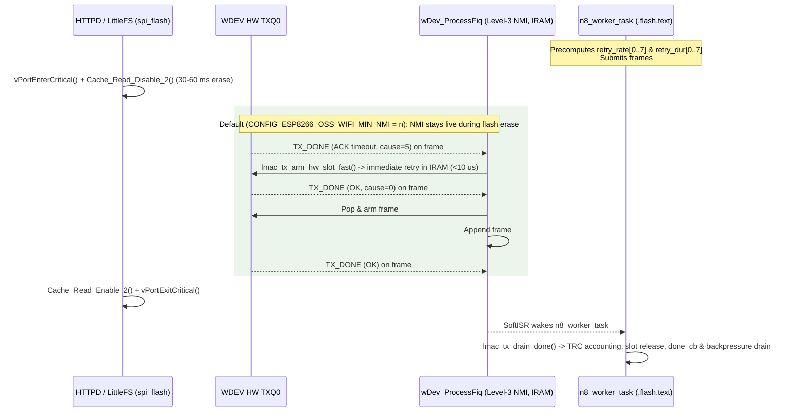

# ESP8266 Open-Source Wi-Fi Network Stack Architecture (`WIFI_DESIGN.md`)

Architectural overview of the clean-room open-source Wi-Fi stack in `components/esp8266/` replacing the proprietary `libphy.a`, `libpp.a` (`_dbg`), and `libnet80211.a` (`_dbg`) archives under `ESP8266_RTOS_SDK` (GCC 16.2).

For module-level provenance, licensing, and Kconfig toggles, see [OSS.md](OSS.md). For reproducible hardware benchmark instructions, see [test/WIFI_BENCHMARK.md](test/WIFI_BENCHMARK.md).

---

## 1. Architectural Goals & Key Differentiators

The open-source Wi-Fi stack preserves 100% source and ABI compatibility with `esp_wifi.h`, `tcpip_adapter` / lwIP (`wlanif`), and `wpa_supplicant` / `hostapd` (WPA2-PSK CCMP/TKIP, WPA3-SAE, 802.11w PMF/BIP with SW CCMP + SA-Query, replay/A-MSDU/fragment guards, opt-in WMM/QoS via `ESP8266_WIFI_QOS_ENABLED`, STA, SoftAP, APSTA, promiscuous sniffer with ctrl filter, `WIFI_PS_MIN_MODEM` / `WIFI_PS_MAX_MODEM` with TSF-synced µs wakeups, regulatory TX power clamping / SoftAP Country IE, and full `esp_wifi_*` API parity) while rethinking memory placement, concurrency, and hardware queue management around the constraints of the Xtensa LX106 (`32 KB` instruction RAM, `80 KB` DRAM, SPI flash XIP cache).

| Dimension | Vendor Blobs (`libphy` / `libpp` / `libnet80211`) | Open-Source Stack (`phy/` / `lmac/` / `net80211/`) | Key Benefit |
| :--- | :--- | :--- | :--- |
| **IRAM Placement** | Blanket `noflash_text` linker rules across `libphy.a` and `libpp.a` (~26.1 KB total static IRAM) | Targeted `IRAM_ATTR` strictly on Level-3 NMI, SoftISR, and flash-disabled RF primitives (~13.0 KB default with IRAM NMI fast TX; ~12.3 KB with [`OSS_WIFI_MIN_NMI=y`](#cfg-oss-wifi-min-nmi)) | **-50.1% to -52.8% static IRAM** (-13.1 to -13.8 KB), unlocking ~19+ KB extra runtime heap |
| **Concurrency Model** | `ppT` task with scheduler-wide `__wifi_task_suspend_all()` (`vTaskSuspendAll`) critical regions | Single serialized cooperative worker (`n8_worker_task`) + lock-free SPSC NMI ring + brief `vPortETSIntrLock()` HW sections | **Zero scheduler freezes**; predictable RTOS & HTTP tail latency |
| **TX Queue Architecture** | Multi-queue hardware WDEV TX (`q=0..7`) with complex `lmac_check_ac` stall recovery | Serialized hardware `TXQ0` with FIFO-preserving software priority (`VO/MGMT/BCN` ahead of `VI/BE/BK`) + default IRAM NMI retry/launch | Eliminates multi-queue WDEV backoff lockups and cuts flash-contention stalls in half |
| **Rate Control (TRC)** | Proprietary closed rate table in `libpp.a` | Pure-integer windowed AARF (`lmac_trc.c`) over 11b/11g/HT20 MCS with non-linear per-packet retry fallback | High sustained throughput (`MCS7`) with rapid weak-link protection |
| **Key Derivation & Reconnect** | Synchronous PBKDF2 / association path; NVS-only credentials | Caller-task eager PBKDF2-SHA1 + [64-byte RTC_SYS warm-reboot PMK & channel cache](#cfg-oss-wifi-rtc-fast-connect) | **Zero worker stalls** during WPA2/WPA3 setup; ~1 s warm-reboot reconnect |
| **Memory Allocation** | Static worst-case SoftAP / connection-manager pools (`g_cnxMgr`, `1,224 B` always resident) | Mode-scoped SoftAP peer slab (allocated on AP start, freed on AP stop); zero `SHN_COMMON` globals | **-26.2% static DRAM** (-3.1 KB) and **-15.0% flash binary** (-87 KB) |
| **RFPLL / Math Runtime** | Mixed soft-float & legacy GCC 5.2 codegen | 100% 64-bit integer fractional-N RFPLL synthesis, spur cancellation, and RTC clock scaling | **0 soft-float helpers** linked; clean GCC 16.2 `-Wall -Wextra -Werror` |

---

## 2. Layered System Architecture

The stack is partitioned into three strictly bounded layers—**RF/PHY (`phy/`)**, **Lower MAC (`lmac/`)**, and **Upper 802.11 MAC (`net80211/`)**—separated by clean C boundaries and a hard execution-context wall between **IRAM (safe while SPI flash cache is disabled)** and **Flash XIP (`.flash.text`)**.

---

## 3. Subsystem Design

### 3.1 RF / Baseband / PHY (`components/esp8266/phy/`)
- **Modularization (SoC `phy` vs. Wi-Fi `phy_rf`)**: Nine focused C modules partitioned into **SoC `phy`** (`CONFIG_ESP8266_OSS_PHY`: `phy_soc.c`, `phy_i2c_pbus.c`, `phy_clock.c`, `phy_adc.c`, `phy_sleep.c` — active in both `OSS_PHY_WIFI` and `OSS_PHY_ONLY`) and **Wi-Fi `phy_rf`** (`CONFIG_ESP8266_OSS_PHY_WIFI`: `phy_rf_chan.c`, `phy_rxgain.c`, `phy_cal_tx.c`, `phy_core.c`) export the full `48`-symbol cross-boundary PHY ABI (`g_phyFuns`, `esp_phy_init_data_t`, `phy_sleep_params_t`) guarded by compile-time `_Static_assert` checks.
- **Minimal IRAM Residency**: Only the **10 functions** invoked from Level-3 NMI or flash-disabled sleep transitions—7 in SoC `phy` (`rom_i2c_*`, `phy_get_mactime`, `clockgate_watchdog`, `pm_goto_sleep`) and 3 in Wi-Fi `phy_rf` (`phy_get_bb_evm`, `phy_fix_cache_bug`, `phy_get_bb_freqoffset`)—reside in IRAM; calibration, channel synthesis, and gain table construction stay in `.flash.text`.
- **Pure-Integer RF Synthesis**: Fractional-N sigma-delta RFPLL tuning, digital spur cancellation (`phy_change_channel`), and 64-bit RTC microsecond conversion (`pm_usec2rtc_64`) use strictly integer arithmetic, avoiding soft-float library overhead.
- **Calibration Persistence**: Full RF/IQ/TX-DC calibration runs on erased NVS and persists checksummed calibration data ([`CONFIG_ESP_PHY_CALIBRATION_AND_DATA_STORAGE`](#cfg-phy-calibration-storage)) for sub-millisecond warm-boot partial calibration reloads.

### 3.2 Lower MAC & WDEV Driver (`components/esp8266/lmac/`)
- **Strict Level-3 NMI Discipline (`lmac_nmi.c`)**:
  - `wDev_ProcessFiq` is compiled with `-fno-jump-tables` and audited via linked-ELF disassembly to guarantee **zero `.flash.text` calls and zero `.flash.rodata` literals** across all reachable callees (including `always_inline` MMIO accessors in `lmac_regs.h`).
  - Strictly preserves `_xt_nmi` / `port.c` invariants: `NMIIrqIsOn` nesting, `WDEV_TSF0_REACH_INT` (`BIT(27)`) priority for `task_wdt` NMI WDT, and clearing `DPORT` NMI enable (`0x3FF00000`) in the epilogue before `rfi 3`.
  - Bridges to the worker via a 32-entry lock-free single-producer/single-consumer ring (`nmi_ring`) and `PendSV(2)` -> `MacIsrSigPostDefHdl()`, plus a dynamically allocated 16-entry `snf_ring` (`0 B` heap when sniffer is off) populated on `LMAC_INT_SNIFFER_END` (`BIT(2)` without `BIT(8)`) after verifying `LMAC_WDEV_RX_STAT_INFO` (`0x00` or `0x41`), frame filters, and `LMAC_WDEV_RX_TSF_LO` / `INT_RAW` / post-copy header torn-read integrity so hardware-delivered `WIFI_PKT_CTRL` frames are captured before `rx_head->buf` is overwritten.
- **Circular RX DMA & Hybrid Ownership (`lmac_dma.c`)**:
  - Contiguous DRAM arena ([`CONFIG_ESP8266_WIFI_RX_BUFFER_NUM`](#cfg-wifi-rx-buffer-num) × `524 B` + `1,600 B` wrap-linearization `extradata` + dummy A-MPDU descriptor).
  - NMI claims completed `lldesc` chains in `< 10 µs` with zero heap allocation or `memcpy`; the worker strips the 4-byte FCS, calibrates RSSI (`raw - 96 dBm`), and applies a hybrid policy ([`CONFIG_ESP8266_WIFI_LEFT_CONTINUOUS_RX_BUFFER_NUM`](#cfg-wifi-left-continuous-rx-buffer-num))—zero-copy into lwIP when contiguous DMA headroom and free DRAM (`> 6 KB`) permit, otherwise heap-copying and immediately recycling DMA descriptors.
- **Serialized Hardware `TXQ0` & Scatter-Gather DMA (`lmac_tx.c`)**:
  - All access categories, management frames, and SoftAP beacons serialize onto hardware **`TXQ0`** (`0x3FF20DC0..0x3FF20DD4`), while software queue insertion maintains strict FIFO-within-priority (`VO / MGMT / BEACON` ahead of `VI / BE / BK`). This avoids ESP8266 WDEV multi-queue backoff lockups (`q=2` freeze under `q=0` contention) and `q=4`/`q=7` timeout strobes.
  - Up to 4 `12 B` DMA descriptors per TX slot (`hdr_buf` + 2 read-only DRAM payload segments + `trailer_buf` for MIC/ICV/FCS; pool sized by [`CONFIG_ESP8266_WIFI_TX_PKT_NUM`](#cfg-wifi-tx-pkt-num)) transmit lwIP `pbuf` payloads without mutating or copying frame bodies.
- **Windowed AARF Transmit Rate Control (`lmac_trc.c`)**:
  - Pure-integer rate adaptation over 11b / 11g / HT20 MCS schedules (`MCS7` initial rate under [`CONFIG_WIFI_TX_RATE_SEQUENCE_FROM_HIGH`](#cfg-wifi-tx-rate-sequence-from-high) with `< -80 dBm` weak-link initial clamp).
  - Evaluates 16-frame or `100 ms` windows (step-up at `<= 12.5%` retry ratio with AARF exponential probe hold `1 -> 2 -> 4 -> 8`; step-down at `>= 1.25` retry-equivalent/frame; emergency fast drop on consecutive failures/heavy retries) plus non-linear per-packet retry fallback `{0, 0, 1, 2, 4, 6, 8}`.
- **Hardware Crypto, Dual-VIF Filtering & Beacons (`lmac_crypto_vif.c`)**:
  - Manages all 25 hardware key slots (`0x3FF21400`, supporting WEP, TKIP, CCMP for STA + SoftAP PTK/GTK) with transparent software CCMP/BIP fallback, dual hardware MAC/BSSID filters, scan wildcard mode (`RX_FILTER_CTRL` bit 4), TSF1 TBTT SoftAP beacons, promiscuous sniffer capture, and 5-bank hardware MAC reset recovery.

### 3.3 IRAM NMI Fast TX Path (Default-Enabled; Disabled via [`CONFIG_ESP8266_OSS_WIFI_MIN_NMI`](#cfg-oss-wifi-min-nmi))
During SPI flash operations (`spi_flash_erase_sector` taking `30–60 ms`, or `spi_flash_read` bursts), ESP8266 disables the SPI flash XIP cache (`Cache_Read_Disable_2`) and masks Level-1 interrupts, pausing all `.flash.text` tasks while **Level-3 NMI (`wDev_ProcessFiq`) remains live in IRAM**.

- **Default Fast Path ([`OSS_WIFI_MIN_NMI=n`](#cfg-oss-wifi-min-nmi))**: Costs only **`+708 B` IRAM** (`+0 B` static DRAM, `+928 B` dynamic heap for a [10-slot TX pool floor](#cfg-wifi-tx-pkt-num)) while retaining **`-13.1 KB` (`-50.1%`)** static IRAM savings over Vendor Blobs.
- **Minimal NMI Mode ([`CONFIG_ESP8266_OSS_WIFI_MIN_NMI=y`](#cfg-oss-wifi-min-nmi))**: Compiles out all fast-TX struct fields, lock paths, and IRAM helpers via `#ifndef CONFIG_ESP8266_OSS_WIFI_MIN_NMI`, reclaiming those `708 B` (`-13.8 KB` / `-52.8%` static IRAM vs. Vendor Blobs).
- **Leak-Free NMI → Worker Handoff**: Completed slots are linked via `slot->next` onto a coalesced `tx_done_head`/`tx_done_tail` FIFO protected against task access with `vPortETSIntrLock()`, consuming `0` `nmi_ring` entries so RX bursts during long flash erases can never drop TX completions.

### 3.4 Upper 802.11 MAC (`components/esp8266/net80211/`)
- **Cooperative Single-Task Worker (`net80211_worker.c`)**: Runs all upper-MAC state machines, bounded LMAC RX/TX batch drains (`16/16`), bounded `ets_timer_proc_one()` callbacks, synchronous `esp_wifi_*` RPCs (`n8_api_call()` marshaling across all mutating config/MAC/protocol/TX-power/vendor-IE/PM APIs), `init_cfg.event_handler` system-event dispatch (with `esp_event_send` fallback), and 100 ms housekeeping on one serialized task ([`CONFIG_ESP8266_OSS_WIFI_TASK_PRIO=13`](#cfg-oss-wifi-task-prio), stack sized by [`CONFIG_WIFI_PPT_TASKSTACK_SIZE`](#cfg-wifi-ppt-taskstack-size)) with critical-section signal coalescing flags (`lmac_evt_queued`, `tx_evt_queued`, `timer_evt_queued`) and **zero `vTaskSuspendAll()` calls**.
- **Backpressured Data Plane, QoS DSCP→TID/AC, Replay Window & Cipher Guards (`net80211_data.c`, `lmac_tx.c`)**: Power-of-two 16-entry `tx_jobs` ring between `tcpip_thread` and `n8_worker_task` checks `esp_lmac_tx_has_free_slot()` before advancing 802.11 sequence numbers or CCMP/TKIP packet numbers. When [`CONFIG_ESP8266_WIFI_QOS_ENABLED`](#cfg-wifi-qos-enabled) (or `ampdu_rx_enable`) is active and the link negotiated WMM/HT, IPv4 DSCP (`eth[15] >> 2`) maps to 802.11 UP/TID `0..7` and LMAC Access Category (`AC_VO`/`VI`/`BE`/`BK`), while EAPOL remains non-QoS on `AC_VO` and `QOS=n` emits 24-byte `0x08` non-QoS frames. On RX, accepts both QoS (`0x88`) and non-QoS (`0x08`), enforces a 64-packet sliding-window PN/TSC replay check with per-TID deduplication (`TID 0..7` + non-QoS `TID 8`), drops unencrypted data (`CVE-2020-26140`) and plaintext EAPOL frames once a PTK is installed, and rejects A-MSDU (`QoS & 0x80`) and fragmented data MPDUs (`MoreFrag` / `FragNum > 0`) by default. For TKIP, WDEV hardware performs RX Michael MIC verification (`rxend_state = 0xF5`, raising supplicant MIC-failure countermeasures / reason `14` on mismatch) and **computes TKIP TX Michael MIC in hardware** (**Live-Silicon Check #1 Outcome A**: confirmed identical over-the-air MIC tail bytes with zero SW MIC pre-computation, eliminating the redundant SW TX Michael MIC pass). In `lmac_tx.c`, encrypted submissions verify a valid HW key slot before allocating a TX slot (`ESP_ERR_NOT_FOUND` on missing key), while software-encrypted frames (`Protected=1`, `cipher=NONE`, e.g., PMF Action/Deauth) steer `hw_key_slot` to the inactive/bypassed opposite VIF and temporarily mask `LMAC_CRYPTO_TX_ENC` when APSTA has both VIFs active so WDEV never double-encrypts, and `hw_crypto_update_vif_reg()` preserves `LMAC_CRYPTO_TX_ENC` across opposite-VIF `BYPASS -> key_set` transitions whenever a software-protected frame is active on `hw_txq[]`.
- **Fast-Connect & Eager Key Derivation (`net80211_nvs_rtc.c`)**: Derives WPA2-PSK PBKDF2-SHA1 eagerly on the caller's task inside `esp_wifi_set_config()` and caches the resulting 32-byte PMK + channel in `64 B` of `RTC_SYS` memory ([`CONFIG_ESP8266_OSS_WIFI_RTC_FAST_CONNECT`](#cfg-oss-wifi-rtc-fast-connect), defaulting to `y` when [`CONFIG_ESP8266_WIFI_NVS_ENABLED`](#cfg-wifi-nvs-enabled) is `n`), enabling warm-reboot STA reconnect in `< 1 s` without blocking the Wi-Fi worker.
- **Associated Scanning, Open-AP Guard, Regulatory Power & LNA Guard (`net80211_scan.c`, `net80211_sta.c`, `net80211_pm.c`)**: Adopts the connected AP's 802.11d Country IE (`WIFI_COUNTRY_POLICY_AUTO`), clamps `phy_set_most_tpw()` to `min(PHY_MAX_WIFI_TX_POWER * 4, active_country->max_tx_power * 4, user_max_tx_power)`, drives close-range `chip_v6_rxmax_ext(3U)` with 5 dB hysteresis (`> -25 dBm` / `< -30 dBm`) across `esp_lmac_set_channel()` resets, enforces [`CONFIG_ESP8266_WIFI_CONNECT_OPEN_ROUTER_WHEN_PWD_IS_SET`](#cfg-wifi-connect-open-router-when-pwd-is-set) and `sta.sort_method` (`BY_SIGNAL` / `BY_SECURITY`) during STA AP selection, drives [active/passive multi-channel scanning](#cfg-scan-ap-max) (bounded by [`CONFIG_SCAN_AP_MAX`](#cfg-scan-ap-max)) with `ETSTimer` (`120 ms` active dual-probe / `360 ms` passive, scatter-gather ProbeReq when vendor IEs exceed 92 B, early exit on directed connect match), pauses off-channel STA data TX, and interleaves `20 ms` home-channel `PM=0` windows so active TCP/HTTP sessions stay responsive during scans.
- **802.11w PMF, WMM IEs, Public APIs, SoftAP & TSF-Synced Modem Sleep (`net80211_sta.c`, `net80211_ap.c`, `net80211_pm.c`, `net80211_api.c`)**: Implements software `ccmp_encrypt`/`ccmp_decrypt` for robust management frames (`Deauth`/`Disassoc`/Robust Action) alongside BIP-CMAC-128 verification for broadcast/multicast robust frames, enforces PMF `mfp=2` (`WIFI_REASON_NO_AP_FOUND` when connecting to non-PMF APs), runs `200 ms` retry / `1000 ms` timeout SA-Query recovery on unprotected Deauth/Disassoc while associated, and keeps an interim `WLAN_STATUS_REQUEST_DECLINED` (`37`) ADDBA Request interlock until P3 A-MPDU RX arrives. Negotiates WMM Info/Parameter IEs on STA and SoftAP, emits SoftAP Country IE (ID 7), supports `esp_wifi_set_rssi_threshold()` (`SYSTEM_EVENT_STA_BSS_RSSI_LOW`), `SYSTEM_EVENT_STA_AUTHMODE_CHANGE`, lazy-allocated vendor IE TX/RX (`esp_wifi_set_vendor_ie{,_cb}`), promiscuous ctrl-subtype filtering, `esp_wifi_set_sta_rx_probe_req()`, `esp_wifi_sta_get_ap_info()` (`wps`/`phy_11b`/`phy_11g`/`freq_offset`/active country), and `esp_wifi_{set,get}_pm_config()`. Allocates the SoftAP station peer slab strictly while SoftAP is running and frees it completely on stop; synchronizes `esp_wifi_get_tsf_time()` against connected AP beacon TSF (`sta_tsf_diff_us` via 64-bit `esp_lmac_get_tsf_us()`) and drives `WIFI_PS_MIN_MODEM` / `WIFI_PS_MAX_MODEM` (`listen_interval` multiplier + TSF-aligned one-shot µs `pm_wake_timer`) in pure-STA mode.

---

## 4. Memory & Binary Footprint Comparison

Measured on `ESPZWApplianceT2` (`esp01_4m`, GCC 16.2, release `-Os`, full STA + SoftAP + WPA2/WPA3-SAE + lwIP + mbedTLS + HTTP/WebDAV + LittleFS + dual-slot OTA):

```mermaid
xychart-beta
    title "Static RAM Footprint (KB, lower is better)"
    x-axis ["Vendor Blobs", "OSS Minimal NMI", "OSS Default (Fast TX)"]
    y-axis "Kilobytes (KB)" 0 --> 28
    bar [25.49, 12.02, 12.71]
    bar [11.67, 8.61, 8.61]
```

*(Left bar: Static IRAM `.iram0.text+.bss`; Right bar: Static DRAM `.dram0.data+.bss`.)*

| Memory Metric (bytes, lower is better) | Vendor Blobs | OSS Minimal NMI ([`OSS_WIFI_MIN_NMI=y`](#cfg-oss-wifi-min-nmi)) | OSS Default ([`OSS_WIFI_MIN_NMI=n`](#cfg-oss-wifi-min-nmi)) |
| :--- | ---: | ---: | ---: |
| **Static IRAM** (`.iram0.text + .bss`, B) | `26,103` | `12,307` ($`\color{green}{-52.8\%}`$) | `13,015` ($`\color{green}{-50.1\%}`$) |
| **Static DRAM** (`.dram0.data + .bss`, B) | `11,952` | `8,820` ($`\color{green}{-26.2\%}`$) | `8,820` ($`\color{green}{-26.2\%}`$) |
| **Flash Code + Rodata** (`.flash.text + .rodata`, B) | `558,824` | `484,648` ($`\color{green}{-13.3\%}`$) | `484,624` ($`\color{green}{-13.3\%}`$) |
| **Firmware Binary** (`firmware.bin`, B) | `582,240` | `495,072` ($`\color{green}{-15.0\%}`$) | `495,760` ($`\color{green}{-14.9\%}`$) |

---

## 5. End-to-End Performance A/B Comparison

Measured back-to-back on identical ESP8266 hardware (160 MHz, 4 MB flash, `ESPZWApplianceT2` base firmware) using [`test/wifi_benchmark.py`](test/wifi_benchmark.py) (`--runs 7`, 5-of-7 trimmed `mean ± stdev`). Deltas are relative to **Vendor Blobs** ($`\color{green}{\text{green}}`$ = better, $`\color{red}{\text{red}}`$ = worse); cells where either build's mean falls within the other's $`\pm 1\sigma`$ range ($`|\mu_{\text{oss}} - \mu_{\text{vendor}}| \le \max(\sigma_{\text{oss}}, \sigma_{\text{vendor}})`$) are marked **`on par`**.

| Metric (unit, lower/higher is better) | Vendor Blobs | OSS Minimal NMI ([`OSS_WIFI_MIN_NMI=y`](#cfg-oss-wifi-min-nmi)) | OSS Default ([`OSS_WIFI_MIN_NMI=n`](#cfg-oss-wifi-min-nmi)) |
| :--- | ---: | ---: | ---: |
| Warm Reboot -> HTTP Ready (ms, lower is better) | 3171.61 ± 15.12 | 2177.94 ± 15.97 ($`\color{green}{-31.3\%}`$) | 2193.42 ± 38.66 ($`\color{green}{-30.8\%}`$) |
| Modem-Sleep Wake Latency (5 s idle) (ms, lower is better) | 110.82 ± 10.32 | 122.01 ± 16.59 (on par) | 121.11 ± 7.81 (on par) |
| Active Wi-Fi Scan (APSTA) (ms, lower is better) | 1808.45 ± 8.19 | 1727.61 ± 19.01 ($`\color{green}{-4.5\%}`$) | 1679.36 ± 29.98 ($`\color{green}{-7.1\%}`$) |
| Idle ICMP RTT (32 B, p50) (ms, lower is better) | 4.29 ± 0.26 | 3.88 ± 0.14 ($`\color{green}{-9.4\%}`$) | 3.79 ± 0.07 ($`\color{green}{-11.6\%}`$) |
| Fragmented ICMP Burst (5800 B, 4-frag) (pps, higher is better) | 37.36 ± 2.82 | 35.58 ± 2.03 (on par) | 37.59 ± 1.70 (on par) |
| Heavy-MTU Saturation (4w x 100 @ 1400 B) (pps, higher is better) | 179.44 ± 22.87 | 167.26 ± 18.68 (on par) | 168.60 ± 12.01 (on par) |
| Heavy-MTU Saturation Tail p99 (4w @ 1400 B)[\*1](#note-heavy-mtu) (ms, lower is better) | 83.54 ± 11.10 | 96.76 ± 11.83 ($`\color{red}{+15.8\%}`$) | 89.58 ± 22.25 (on par) |
| Uncontested Downlink (1 MB flash read) (KB/s, higher is better) | 207.79 ± 1.39 | 226.11 ± 8.49 ($`\color{green}{+8.8\%}`$) | 236.06 ± 7.87 ($`\color{green}{+13.6\%}`$) |
| Flash-Read Contended Downlink (1 MB + 1400 B) (KB/s, higher is better) | 193.68 ± 5.68 | 195.92 ± 7.02 (on par) | 205.17 ± 12.36 (on par) |
| WebDAV Storage Write (128 KB PUT) (KB/s, higher is better) | 72.39 ± 1.99 | 72.80 ± 1.13 (on par) | 74.75 ± 1.27 ($`\color{green}{+3.3\%}`$) |
| WebDAV Storage Read (128 KB GET) (KB/s, higher is better) | 127.66 ± 7.74 | 141.87 ± 6.46 ($`\color{green}{+11.1\%}`$) | 141.74 ± 9.62 ($`\color{green}{+11.0\%}`$) |
| Flash-Erase Contention Probe p95 (PUT + 32 B) (ms, lower is better) | 45.77 ± 4.92 | 54.62 ± 9.20 (on par) | 48.55 ± 8.65 (on par) |
| Flash-Erase Contention Stalls >40 ms (PUT + 32 B) (%, lower is better) | 10.22 ± 4.78 | 13.56 ± 5.08 (on par) | 10.81 ± 5.57 (on par) |
| Flash-Erase Burst Contention PUT (PUT + 4200 B)[\*2](#note-flash-erase) (KB/s, higher is better) | 69.34 ± 2.84 | 63.98 ± 2.89 ($`\color{red}{-7.7\%}`$) | 66.28 ± 2.21 ($`\color{red}{-4.4\%}`$) |
| Flash-Erase Burst Contention Probe p95 (+4200 B)[\*2](#note-flash-erase) (ms, lower is better) | 46.40 ± 8.10 | 76.41 ± 10.31 ($`\color{red}{+64.7\%}`$) | 72.99 ± 4.23 ($`\color{red}{+57.3\%}`$) |
| Concurrent HTTP Close (6w x 25 /!sys/discover) (req/s, higher is better) | 33.31 ± 1.91 | 35.67 ± 0.60 ($`\color{green}{+7.1\%}`$) | 33.96 ± 2.31 (on par) |
| Concurrent HTTP Keep-Alive (4w x 40 boot_serial) (req/s, higher is better) | 45.93 ± 1.55 | 48.16 ± 2.07 ($`\color{green}{+4.9\%}`$) | 49.06 ± 1.12 ($`\color{green}{+6.8\%}`$) |

*(All values are 5-of-7 trimmed means ± stdev from matched back-to-back sessions on live 2.4 GHz air; `0` HTTP errors across all runs.)*

### Performance Notes

- **[\*1] Heavy-MTU Saturation Tail p99 (`+15.8%` on Minimal NMI; `on par` on Default)**: Under sustained 4-worker 1400 B floods, deferring TX retries and next-slot launches to the flash-resident worker ([`OSS_WIFI_MIN_NMI=y`](#cfg-oss-wifi-min-nmi)) adds tail queueing latency during transient 2.4 GHz collision bursts. Enabling the default IRAM NMI fast TX path ([`OSS_WIFI_MIN_NMI=n`](#cfg-oss-wifi-min-nmi)) brings tail p99 back within `±1σ` of Vendor Blobs.
- **[\*2] Flash-Erase Burst Contention (`PUT + 4200 B`, `-4.4%` PUT / `+57.3%` probe p95)**: Deliberate IRAM-vs.-stall trade-off. During 30–60 ms `spi_flash_erase_sector()` calls (`Cache_Read_Disable_2`), vendor `libpp.a` keeps nearly the entire MAC/TRC scheduler in IRAM (`26.1 KB`), whereas OSS reclaims ~13 KB of IRAM by keeping `n8_worker_task` and lwIP in `.flash.text`. On single-frame `PUT + 32 B` probes, OSS stays `on par` with Vendor Blobs, while incoming 3-fragment `4200 B` ICMP echoes still require `.flash.text` lwIP reassembly and reply generation once flash cache re-enables, leaving a wider probe `p95` tail.

---

## 6. Kconfig & Tuning Options

For top-level `Open-Source / Vendor Blob Selection` choices (`ESP8266_PHY_WIFI_IMPL`, hidden derived `ESP8266_OSS_PHY`, `ESP8266_HAL_IMPL`, `ESP8266_CORE_IMPL`, and `sdkconfig.defaults` notes), see [OSS.md §3](OSS.md#3-consumer-kconfig-reference). Under `CONFIG_ESP8266_OSS_PHY_ONLY=y`, `menu Wi-Fi` and the 3 Wi-Fi-RF `menu PHY` prompts are hidden while keeping `ESP_PHY_INIT_DATA_VDD33_CONST` visible for SAR ADC / VDD33.

### 6.1 OSS-Only Wi-Fi Tuning Knobs (`menu Wi-Fi`, `depends on ESP8266_OSS_PHY_WIFI`)

- **`CONFIG_ESP8266_OSS_WIFI_MIN_NMI`** (`bool`, default `n`): Toggles the IRAM Level-3 NMI fast TX retry/launch path in `lmac_nmi.c` (`+708 B` static IRAM and a `10`-slot TX pool floor when `n`; reclaims `708 B` static IRAM and allows `TX_PKT_NUM < 10` when `y`).
- **`CONFIG_ESP8266_OSS_WIFI_TASK_PRIO`** (`int 1..14`, default `13`): FreeRTOS priority for `n8_worker_task` (clamped `< configMAX_PRIORITIES`).
- **`CONFIG_ESP8266_OSS_WIFI_RTC_FAST_CONNECT`** (`bool`, default `y if !ESP8266_WIFI_NVS_ENABLED` else `n`): Caches the 32-byte derived WPA2 PMK, BSSID, and channel in `64 B` of `RTC_SYS` across warm resets/OTA reboots (auto-cleared on POR).

### 6.2 Active Shared Wi-Fi & Wi-Fi-RF PHY Options

- **`CONFIG_WIFI_PPT_TASKSTACK_SIZE`** (`int 2048..8192`, default `2048` or `5120` with WPA3-SAE; prompt hidden under `OSS_PHY_ONLY`): In OSS mode, sizes `n8_worker_task` stack, silently floored at **`3072 B`** at runtime.
- **`CONFIG_SCAN_AP_MAX`** (`int 1..100`, default `99`): Caps scan result storage; OSS caps stored AP records at **`64`** (`net80211_scan.c`), while Vendor Wi-Fi honors up to `100`.
- **`CONFIG_WIFI_TX_RATE_SEQUENCE_FROM_HIGH`** (`bool`, default `y`): In OSS mode (`lmac_trc.c`), `y` initializes windowed AARF at `MCS7`/`54M` (clamped on weak `< -80 dBm` links) and `n` initializes at `MCS4`/`24M`.
- **`CONFIG_ESP8266_WIFI_QOS_ENABLED`** (`bool`, default `n`; auto-selected by `ESP8266_WIFI_AMPDU_RX_ENABLED`): Enables end-to-end WMM/QoS negotiation (STA WMM Info IE, SoftAP WMM Parameter IE) and IPv4 DSCP→TID/AC QoS Data (`0x88`) framing (EAPOL remains non-QoS on `AC_VO`); when `n`, TX emits 24-byte `0x08` non-QoS frames while RX still accepts both `0x08` and `0x88`.
- **`CONFIG_ESP8266_WIFI_RX_BUFFER_NUM`** (`int 14..28`, default `16`): Allocates the contiguous `524 B`/buffer RX DMA arena; OSS caps count at **`24`** (`LMAC_MAX_RX_BUFS`).
- **`CONFIG_ESP8266_WIFI_LEFT_CONTINUOUS_RX_BUFFER_NUM`** (`int 0..16`, default `16`): Sets the OSS hybrid zero-copy vs. heap-copy RX threshold (`free_contiguous > threshold && free_8bit > 6 KB`). Default `16` always copies to heap and recycles DMA immediately; setting `< RX_BUFFER_NUM - 1` enables zero-copy RX into lwIP.
- **`CONFIG_ESP8266_WIFI_TX_PKT_NUM`** (`int 4..16`, default `6`): Sizes the scatter-gather TX DMA slot pool (~`216 B`/slot default or ~`188 B`/slot with `OSS_WIFI_MIN_NMI=y`), floored at **`10`** slots when `OSS_WIFI_MIN_NMI=n` (`4..9` apply only when `MIN_NMI=y`).
- **`CONFIG_ESP8266_WIFI_NVS_ENABLED`** (`bool`, default `y`): Enables NVS Wi-Fi config persistence (`nvs.net80211`); disabling it causes `ESP8266_OSS_WIFI_RTC_FAST_CONNECT` to default to `y`.
- **`CONFIG_ESP8266_WIFI_ENABLE_WPA3_SAE`** (`bool`, default `y`): Compile-time WPA3-SAE gate active across `wpa_supplicant` and `net80211`, synchronized with runtime `init_cfg.wpa3_sae_enable` override support.
- **`CONFIG_ESP8266_WIFI_CONNECT_OPEN_ROUTER_WHEN_PWD_IS_SET`** (`bool`, default `y`): Controls whether STA AP selection allows connecting to Open/unencrypted APs when `sta.password` is non-empty (`n` rejects Open candidates with `WIFI_REASON_NO_AP_FOUND`).
- **`CONFIG_ESP_PHY_CALIBRATION_AND_DATA_STORAGE`** (`bool`, default `y`, prompt hidden under `OSS_PHY_ONLY`): NVS persistence for RF/IQ/TX-DC calibration data (`source/phy_init.c`).
- **`CONFIG_ESP_PHY_INIT_DATA_IN_PARTITION`** (`bool`, default `n`, prompt hidden under `OSS_PHY_ONLY`): Loads 128-byte PHY init data from the `phy` flash partition instead of the embedded binary.
- **`CONFIG_ESP8266_PHY_MAX_WIFI_TX_POWER`** (`int 0..21 dBm`, default `20`, prompt hidden under `OSS_PHY_ONLY`): Max Wi-Fi TX power ceiling applied in `phy_init_data.h` and `net80211_nvs_rtc.c`.

### 6.3 Options Pending Alignment & Vendor-Only Gated Options

| Option(s) | Status / Guard | Notes |
| :--- | :--- | :--- |
| `ESP8266_WIFI_AMPDU_RX_ENABLED` / `ESP8266_WIFI_RX_BA_WIN_SIZE` | Shared — alignment pending | Tracked for Phase 3 Block-Ack RX alignment in `WIFICONFIG_ALIGN_PLAN.md` (currently kept compatible in `Kconfig` and `WIFI_INIT_CONFIG_DEFAULT()`, with `select ESP8266_WIFI_QOS_ENABLED` wired). |
| `ESP8266_WIFI_AMSDU_ENABLED`, `ESP8266_WIFI_RX_PKT_NUM` | `depends on ESP8266_VENDOR_PHY_WIFI` | Vendor-only (`esp_wifi.h` provides `#ifdef` fallback `WIFI_RX_PKT_NUM = 7` when omitted in OSS/PHY-only builds). |
| `ESP8266_WIFI_DEBUG_LOG_ENABLE` (+ 21 level/submodule children) | `depends on ESP8266_VENDOR_PHY_WIFI` | Controls vendor `*_dbg.a` archives (`SUBMODULE_ESPNOW` also requires `ESP8266_VENDOR_ESPNOW`). OSS Wi-Fi uses standard `ESP_LOG*`. |

## 7. Future Work — Deferred External-AP & A-MPDU-TX Live-Verification Gaps

While all security primitives implemented in Phase 1 (TKIP HW RX `0xF5` & TX MIC, SW CCMP PMF Action/Deauth, BIP-CMAC-128, SA-Query recovery & `1000 ms` timeout, `CVE-2020-26140` plaintext/EAPOL drop, 64-packet sliding-window replay, A-MSDU/fragment drop, `CONNECT_OPEN_ROUTER_WHEN_PWD_IS_SET`, and SoftAP CCMP/plaintext reject) are verified in two-board HIL testing (Run 11) plus host empirical verification (`tcc`) across post-Run-11 LMAC/replay remediations (with follow-up live two-board Run 12 awaiting Board #2 `:3040` host RFC2217 bridge recovery), the following four external-infrastructure / post-P1 live-verification gaps remain deferred:

1. **Real WPA3-SAE External AP & Check #2 SAE Stress (Deferred from P1)**: Requires a real third-party WPA3-SAE router/hostapd AP (or multi-board SAE AP peer) to live-verify `CONFIG_ESP8266_WIFI_ENABLE_WPA3_SAE=y` / `init_cfg.wpa3_sae_enable` interoperability, H2E/hunting-and-pecking commits, and SAE reconnection stress on hardware.
2. **WPS PBC External Registrar (Deferred to P4)**: Live Wi-Fi Protected Setup Push-Button Configuration handshake testing against an external WPS Registrar AP.
3. **WPA2-Enterprise FreeRADIUS External AP (Deferred to P4)**: Live 802.1X / EAP-TLS / PEAP / TTLS authentication against a real FreeRADIUS + Enterprise AP setup.
4. **A-MPDU TX SoftAP RX & Fragmented-A-MPDU (`CVE-2020-26146`) Check (Deferred to P3)**: Hardware/peer A-MPDU aggregation interoperability against an A-MPDU-capable STA/AP (including fragmented A-MPDU drop verification once P3 `AMPDU_RX_ENABLED` / `RX_BA_WIN_SIZE` / `RX_DEFRAG` support is implemented).
